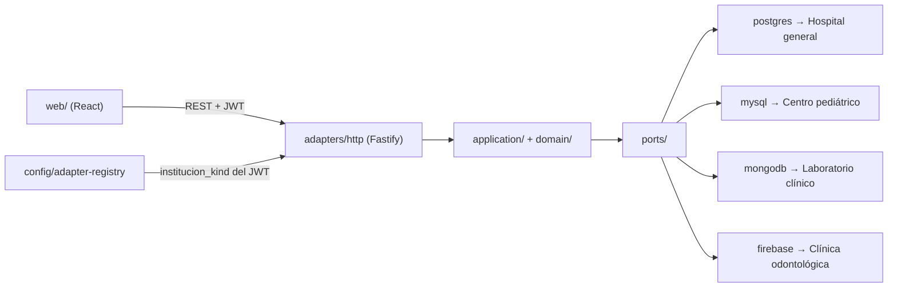

# Arquitectura — Genki Health

Resumen de cómo está construida la aplicación de la Entrega II. Las decisiones de fondo están en `decisiones/` (ADR-0001…0005) y la comparación entre motores en `documento-comparativo.md`.

## 1. Capas (arquitectura hexagonal)

| Capa | Ruta | Responsabilidad |
| --- | --- | --- |
| Cliente web | `web/` | SPA React + Vite. Consume la API REST; no conoce el motor. |
| Tipos compartidos | `shared/` | DTO, claims del JWT y asignación institución → motor (`shared/src/engines.ts`). |
| HTTP | `server/src/adapters/http/` | Rutas Fastify, validación de entrada (Zod) y control de roles. |
| Casos de uso | `server/src/application/` | Registrar paciente, listar, historial, cerrar consulta, archivar. |
| Dominio | `server/src/domain/` | Reglas del paquete clínico y estados del expediente. |
| Puertos | `server/src/ports/` | Interfaces de repositorio, unidad de trabajo, ids y reloj. |
| Adaptadores de persistencia | `server/src/adapters/{postgres,mysql,mongodb,firebase}/` | Un adaptador por motor, con driver nativo y sin ORM. `memory/` es la referencia para pruebas. |
| Composición | `server/src/config/` | Arma un `AdapterSet` por institución y lo registra (`adapter-registry.ts`, `compose-engines.ts`). |

`application/` y `domain/` solo dependen de `ports/`. Esa regla la verifica `npm run depcruise` (`.dependency-cruiser.cjs`).

## 2. Enrutamiento de cada solicitud a su motor

1. `POST /api/auth/login` recibe correo, contraseña e institución. La identidad se valida contra el PostgreSQL del hospital (Argon2id) y se emiten un access JWT (30 min) y un refresh JWT (14 días).
2. El access JWT lleva `institucion_id`, `institucion_kind`, `roles` y `motor`.
3. En cada ruta protegida, `requirePrincipal` verifica el token y la ruta llama `registry.resolve(institution_kind, id_institucion)` (`server/src/adapters/http/app.ts`). El registro solo acepta las parejas fijas 1 → PostgreSQL, 2 → MySQL, 3 → MongoDB y 4 → Firestore, y devuelve el `AdapterSet` de esa institución.
4. El caso de uso se ejecuta igual para las cuatro instituciones; solo cambian los adaptadores. Por eso la UI y las rutas REST son las mismas para todos los motores.
5. Un usuario normal no puede cambiar de institución. El `superadministrador` de evaluación entra a `/panel` y elige institución con `POST /api/auth/select-institution`, que reemite el JWT para la institución elegida.

`POST /api/auth/logout` revoca el refresh token. El access token ya emitido sigue válido hasta que vence (máximo 30 min), porque el JWT no guarda estado. Es un riesgo aceptado para esta entrega.

## 3. Mantenimiento del historial clínico

- **Registro de paciente nuevo:** `POST /api/pacientes` crea paciente y expediente en una transacción (más responsables en pediatría). Pantalla `/pacientes/nuevo`.
- **Consulta con diagnóstico, tratamiento y receta:** `POST /api/pacientes/:id/consultas` guarda el paquete completo o nada. Una consulta abierta se cierra con `POST /api/consultas/:id/cierre`.
- **Corrección y anulación:** `PATCH /api/{diagnosticos|tratamientos|recetas}/:id` y `POST /api/{…}/:id/anulacion`, con motivo obligatorio. Nunca se borra: anular cambia el estado y deja una fila en la bitácora del mismo motor, dentro de la misma transacción (`server/src/adapters/http/clinical-maintenance-routes.ts`).
- **Archivo y reactivación:** `POST /api/pacientes/:id/archivo` pasa el expediente a `archivado` con motivo; `POST /api/pacientes/:id/reactivacion` lo reactiva sin perder historial. Con una consulta abierta, archivar responde `409`.

## 4. Modos de ejecución

`GENKI_MODE=engines` usa los cuatro motores reales (PostgreSQL, MySQL y MongoDB en Docker; Firestore en su emulador local). `GENKI_MODE=memory` usa el adaptador en memoria y solo sirve para desarrollo y pruebas: los datos no persisten.
