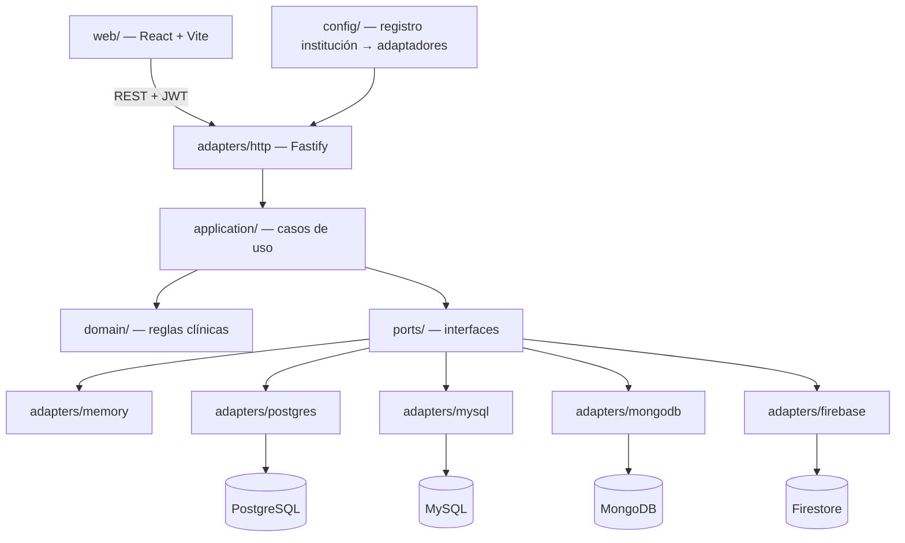

# Genki Health

Plataforma compartida de historiales clínicos para cuatro instituciones médicas independientes. Cada institución guarda sus datos en un motor de base de datos distinto, y una sola aplicación cliente-servidor atiende a las cuatro.

Proyecto final de **Bases de Datos II**, Facultad de Ingeniería, Universidad Rafael Landívar.

| | |
| --- | --- |
| Integrantes | Carlos Hugo Escobar Gómez y Héctor Jordin Adolfo García Coyoy |
| Catedrático | Ing. José Arturo Monterroso |
| Enunciado del curso | [`PROJECT-DESC.md`](PROJECT-DESC.md) |
| Entrega I (análisis y modelo relacional) | [`docs/entregas/entrega-1/`](docs/entregas/entrega-1/) |
| Entrega II (aplicación) | Código en `server/`, `web/` y `shared/`; plan en [`docs/plan/E2-EXECUTABLE.md`](docs/plan/E2-EXECUTABLE.md) |
| Arquitectura detallada | [`docs/ARCHITECTURE.md`](docs/ARCHITECTURE.md) |

---

## Índice

1. [El caso](#el-caso)
2. [Instituciones y motores](#instituciones-y-motores)
3. [Estado del proyecto](#estado-del-proyecto)
4. [Entrega I: análisis y modelo relacional](#entrega-i-análisis-y-modelo-relacional)
5. [Entrega II: aplicación cliente-servidor](#entrega-ii-aplicación-cliente-servidor)
6. [Arquitectura](#arquitectura)
7. [Reglas del dominio clínico](#reglas-del-dominio-clínico)
8. [Autenticación y enrutamiento por institución](#autenticación-y-enrutamiento-por-institución)
9. [API disponible](#api-disponible)
10. [Cómo ejecutarlo](#cómo-ejecutarlo)
11. [Scripts de npm](#scripts-de-npm)
12. [Calidad: compuerta local y CI](#calidad-compuerta-local-y-ci)
13. [Estructura del repositorio](#estructura-del-repositorio)
14. [Documentación](#documentación)
15. [Forma de trabajo](#forma-de-trabajo)

---

## El caso

Una red de instituciones médicas independientes comparte una misma plataforma de historiales clínicos, pero cada institución es dueña de su propia infraestructura de datos. No existe una base de datos central de pacientes.

El curso pide comparar motores en la práctica: las mismas reglas de negocio (registrar una consulta, agregar un diagnóstico, recetar un medicamento) sobre modelos de datos distintos. La arquitectura hexagonal permite que la lógica de negocio no dependa del motor, de modo que cambiar de motor sea una decisión de configuración. Lo que se evalúa son las decisiones de modelado, consistencia y seguridad de cada motor.

Restricciones del enunciado:

- Cada institución usa un motor distinto; ningún motor se repite.
- Se usan al menos cuatro motores (en la práctica, uno por institución).
- No se aceptan motores ligeros sin gestión real (SQLite, Realm, LiteDB).
- La asignación institución → motor se justifica por escrito en el documento comparativo de la Entrega II.

## Instituciones y motores

La asignación está cerrada en [`poteto-mode/decisions/locked.md`](poteto-mode/decisions/locked.md) y codificada en `@genki/shared` como `INSTITUTION_ENGINE_ASSIGNMENTS` ([`shared/src/engines.ts`](shared/src/engines.ts)).

| Institución | `institution_kind` | Motor | Por qué encaja |
| --- | --- | --- | --- |
| Hospital general | `hospital_general` | **PostgreSQL** | Necesita integridad transaccional fuerte en citas, diagnósticos y tratamientos: no puede perderse un diagnóstico a medias. |
| Centro médico pediátrico | `centro_pediatrico` | **MySQL** | Datos estructurados de seguimiento (crecimiento, vacunación) y consultas frecuentes y cortas. |
| Laboratorio clínico | `laboratorio_clinico` | **MongoDB** | Los resultados cambian de forma según el tipo de examen (hematología, orina, cultivo). |
| Clínica odontológica | `clinica_odontologica` | **Firebase (Firestore)** | No tiene personal técnico y prioriza flujos simples para sus secretarias. |

En la Entrega I, los modelos entidad-relación y relacional se dibujan solo para las dos instituciones relacionales (Hospital general y Centro pediátrico). Las entidades, atributos, clasificación de datos y operaciones cubren las cuatro.

## Estado del proyecto

Actualizado al **9 de noviembre de 2026**.

### Resumen

| Área | Estado |
| --- | --- |
| Entrega I: análisis, entidades, atributos, clasificación, normalización, operaciones | ✅ Completo |
| Entrega I: diagramas ER generales y modelo relacional | ✅ Completo |
| Entrega I: diagramas Chen detallados (sección 6.4) | 🟡 Faltan los pediátricos (ticket E1-05) |
| Entrega II: base del monorepo, contratos congelados, CI | ✅ En `main` |
| Entrega II: núcleo en memoria (pacientes, consultas, archivo, sesión JWT, API HTTP) | ✅ En `main` |
| Entrega II: motores locales con Docker (PostgreSQL, MySQL, MongoDB) | ✅ En `main` |
| Entrega II: adaptadores reales de los cuatro motores | 🟡 En PRs en borrador, sin fusionar |
| Entrega II: módulos completos (agenda, caja, especialidades, usuarios, UI) | 🟡 En PRs en borrador, sin fusionar |
| Entrega II: documento comparativo | 🟡 Redactado en el PR #63 (borrador) |

### Tickets de Entrega I

| ID | Tarea | Estado | PR |
| --- | --- | --- | --- |
| E1-02 | Chen del núcleo clínico (paciente, expediente, agenda, consulta, diagnóstico, receta, acceso) | Hecho | [#3](https://github.com/carloshugoeg/genki-health/pull/3) |
| E1-03 | Chen de facturación, personal e insumos | Hecho | [#8](https://github.com/carloshugoeg/genki-health/pull/8) |
| E1-04 | Chen de hospitalización | Hecho | [#4](https://github.com/carloshugoeg/genki-health/pull/4) |
| E1-05 | Chen del centro pediátrico (responsable, antecedente perinatal, crecimiento, vacunación) | **Pendiente** (Jordin) | — |
| E1-06 | Decisión humana sobre atributos en conflicto | Hecho | [#7](https://github.com/carloshugoeg/genki-health/pull/7) |

### Tickets de Entrega II ya fusionados en `main`

| ID | Qué entregó | PR |
| --- | --- | --- |
| E2-01 / E2-P0-01 | Base del monorepo (Fastify + React/Vite) y fin de la regla "solo Entrega I" | [#9](https://github.com/carloshugoeg/genki-health/pull/9), [#10](https://github.com/carloshugoeg/genki-health/pull/10) |
| E2-P0-02 | Sincronización de los tableros de seguimiento | [#11](https://github.com/carloshugoeg/genki-health/pull/11) |
| E2-P0-03 | CI confiable en `main` | [#12](https://github.com/carloshugoeg/genki-health/pull/12) |
| E2-P1-01 | Contrato congelado de API y puertos | [#13](https://github.com/carloshugoeg/genki-health/pull/13) |
| E2-P1-02 | Esquema físico SQL congelado (PostgreSQL y MySQL) | [#14](https://github.com/carloshugoeg/genki-health/pull/14) |
| E2-P1-03 | Contratos de documentos, seguridad y semillas; ADR 0003–0005 | [#15](https://github.com/carloshugoeg/genki-health/pull/15) |
| E2-P1-04 | Índice ejecutable de tickets y lista de compuertas | [#16](https://github.com/carloshugoeg/genki-health/pull/16) |
| E2-P2-01 | DTOs del MVP, esquemas HTTP estrictos y errores clínicos tipados | [#17](https://github.com/carloshugoeg/genki-health/pull/17) |
| E2-P2-02 | Suite de contrato única para todos los adaptadores (17 casos) | [#18](https://github.com/carloshugoeg/genki-health/pull/18) |
| E2-P2-03 | Transacciones aisladas reales en el adaptador de memoria | [#21](https://github.com/carloshugoeg/genki-health/pull/21) |
| E2-P2-04 | Alta de paciente, responsables, búsqueda y archivo (memoria) | [#22](https://github.com/carloshugoeg/genki-health/pull/22) |
| E2-P2-05 | Invariantes puras de la consulta | [#19](https://github.com/carloshugoeg/genki-health/pull/19) |
| E2-P2-06 | Consulta cerrada en memoria; suite de contrato 17/17 en verde | [#23](https://github.com/carloshugoeg/genki-health/pull/23) |
| E2-P2-07 | API HTTP de búsqueda, historial, catálogos y archivo | [#24](https://github.com/carloshugoeg/genki-health/pull/24) |
| E2-P2-09 | Servicio JWT independiente del motor, con puerto de sesiones | [#20](https://github.com/carloshugoeg/genki-health/pull/20) |
| E2-P3A-01 | Motores locales deterministas y comandos seguros de arranque | [#25](https://github.com/carloshugoeg/genki-health/pull/25) |
| FS-FOUNDATION | Contratos aditivos de módulos para el sistema completo | [#26](https://github.com/carloshugoeg/genki-health/pull/26) |

### Trabajo en revisión (PRs en borrador)

Estos PRs existen en GitHub pero **todavía no están en `main`**. Muchos dependen unos de otros.

| Tema | PRs |
| --- | --- |
| Consulta atómica por HTTP y cierre de la compuerta de memoria | [#47](https://github.com/carloshugoeg/genki-health/pull/47), [#49](https://github.com/carloshugoeg/genki-health/pull/49) |
| PostgreSQL (Hospital general) | [#39](https://github.com/carloshugoeg/genki-health/pull/39), [#43](https://github.com/carloshugoeg/genki-health/pull/43) |
| MySQL (Centro pediátrico) | [#41](https://github.com/carloshugoeg/genki-health/pull/41), [#44](https://github.com/carloshugoeg/genki-health/pull/44), [#46](https://github.com/carloshugoeg/genki-health/pull/46), [#48](https://github.com/carloshugoeg/genki-health/pull/48) |
| MongoDB (Laboratorio clínico) | [#32](https://github.com/carloshugoeg/genki-health/pull/32), [#40](https://github.com/carloshugoeg/genki-health/pull/40), [#42](https://github.com/carloshugoeg/genki-health/pull/42), [#45](https://github.com/carloshugoeg/genki-health/pull/45) |
| Firestore (Clínica odontológica) | [#30](https://github.com/carloshugoeg/genki-health/pull/30), [#50](https://github.com/carloshugoeg/genki-health/pull/50), [#51](https://github.com/carloshugoeg/genki-health/pull/51), [#53](https://github.com/carloshugoeg/genki-health/pull/53) |
| Módulos del sistema completo (expediente, agenda, adjuntos, cargos) | [#27](https://github.com/carloshugoeg/genki-health/pull/27)–[#29](https://github.com/carloshugoeg/genki-health/pull/29), [#31](https://github.com/carloshugoeg/genki-health/pull/31), [#33](https://github.com/carloshugoeg/genki-health/pull/33)–[#38](https://github.com/carloshugoeg/genki-health/pull/38) |
| Líneas de integración (clínica compartida, especialidades, usuarios, caja y agenda) | [#55](https://github.com/carloshugoeg/genki-health/pull/55), [#56](https://github.com/carloshugoeg/genki-health/pull/56), [#58](https://github.com/carloshugoeg/genki-health/pull/58)–[#60](https://github.com/carloshugoeg/genki-health/pull/60) |
| Interfaz web (login, pacientes, superadmin, dashboard) | [#52](https://github.com/carloshugoeg/genki-health/pull/52), [#54](https://github.com/carloshugoeg/genki-health/pull/54), [#62](https://github.com/carloshugoeg/genki-health/pull/62) |
| Correcciones con motores reales | [#57](https://github.com/carloshugoeg/genki-health/pull/57), [#61](https://github.com/carloshugoeg/genki-health/pull/61) |
| Documento comparativo de la Entrega II | [#63](https://github.com/carloshugoeg/genki-health/pull/63) |

El ticket actual y los siguientes listos están en [`poteto-mode/queue/NOW.md`](poteto-mode/queue/NOW.md). El tablero completo está en [`docs/progress/TASKS.md`](docs/progress/TASKS.md).

## Entrega I: análisis y modelo relacional

Documento: [`docs/entregas/entrega-1/entrega-i.pdf`](docs/entregas/entrega-1/entrega-i.pdf), con su transcripción en [`analisis-y-modelo-relacional.md`](docs/entregas/entrega-1/analisis-y-modelo-relacional.md).

| Resultado que pide el enunciado | Sección | Dónde está |
| --- | --- | --- |
| Modelo entidad-relación (instituciones relacionales) | 6 | `diagramas/er-hospital-general.*`, `diagramas/er-centro-pediatrico.*` y detalle `diagramas/chen-6.4.*` |
| Modelo relacional | 7 | `diagramas/rel-*.mmd` y sección 7 de la transcripción |
| Entidades identificadas (58 en total) | 4 | Transcripción |
| Atributos por entidad | 5 | Transcripción |
| Datos públicos, confidenciales y restringidos | 9 | Transcripción |
| Base de datos normalizada | 8 | Transcripción |
| Operaciones en lenguaje sencillo (OP-01 a OP-77) | 10 | Transcripción |

### Diagramas Chen (sección 6.4)

| Diagrama | Contenido | Estado |
| --- | --- | --- |
| 6.4.1 | Paciente, expediente, contacto de emergencia | ✅ |
| 6.4.2 | Agenda, consulta, signos vitales | ✅ |
| 6.4.3 | Diagnóstico, tratamiento, receta | ✅ |
| 6.4.4 | Hospitalización (Hospital general) | ✅ |
| 6.4.5 | Acceso, roles, auditoría | ✅ |
| 6.4.6 – 6.4.8 | Responsable y antecedente perinatal, crecimiento, vacunación (Centro pediátrico) | ⏳ E1-05 |
| 6.4.9 | Facturación | ✅ |
| 6.4.10 | Personal y honorarios | ✅ |
| 6.4.11 | Insumos y cargos | ✅ |

Los diagramas se generan con Graphviz (`.dot` → `.png`). La clave de formas compartida está en [`docs/entregas/entrega-1/diagramas/README.md`](docs/entregas/entrega-1/diagramas/README.md) y no se reescribe.

### Módulos del modelo relacional

| Módulo | Entidades principales | Archivo |
| --- | --- | --- |
| Acceso y auditoría | Institución, usuario, rol, bitácora | `rel-acceso.mmd` |
| Paciente y expediente | Paciente, expediente, contacto de emergencia | `rel-paciente-expediente.mmd` |
| Atención clínica | Cita, consulta, diagnóstico, tratamiento, receta | `rel-atencion.mmd` |
| Hospitalización | Cama, servicio, nota de evolución, procedimiento | `rel-hospitalizacion.mmd` |
| Facturación | Tarifario, factura, pago | `rel-facturacion.mmd` |
| Personal e insumos | Profesional, honorario, insumo, cargo | `rel-personal-insumos.mmd` |
| Extensiones pediátricas | Responsable, antecedente perinatal, crecimiento, vacunación | `rel-pediatrico.mmd` |

### Conflictos de atributos resueltos (E1-06)

Carlos cerró el 14 de octubre de 2026 cinco diferencias entre la sección 5 y la sección 7.4. El detalle está en `locked.md`:

1. **PROFESIONAL:** el modelo relacional queda como en 7.4, sin `id_tipo_personal`, `modalidad_contrato` ni `fecha_ingreso`.
2. **CAMA:** se agregan `tipo_cama` y `codigo_servicio`.
3. **MUNICIPIO:** se agrega como catálogo para que `PACIENTE.id_municipio` tenga destino.
4. **NOTA_EVOLUCION:** se agrega una llave opcional a la nota anterior (una corrección es una nota nueva).
5. **`numero_colegiado`:** obligatorio solo si el tipo de personal lo requiere; si no, `NULL`; único entre valores no nulos.

## Entrega II: aplicación cliente-servidor

El enunciado pide:

- Aplicación funcional con conexión cliente-servidor.
- Modelo de datos corregido a partir de la retroalimentación de la Entrega I.
- Consultas equivalentes en los cuatro motores.
- Para MongoDB y Firestore, decisión justificada de qué se embebe y qué se referencia.
- Una interfaz que no cambia según el motor activo.
- Registro de pacientes nuevos y mantenimiento del historial (consultas, diagnósticos, tratamientos, recetas).
- Archivo de historiales por baja del paciente (traslado, fallecimiento u otra causa).
- Enrutamiento automático al motor de la institución del usuario al iniciar sesión.
- Documento comparativo: modelado, consistencia, seguridad y justificación de la asignación.

### Contratos congelados

Antes de escribir los adaptadores se congelaron los contratos que todos los motores deben cumplir:

| Contrato | Archivo |
| --- | --- |
| Reglas centrales | [`docs/plan/contracts/CORE.md`](docs/plan/contracts/CORE.md) |
| API HTTP | [`docs/plan/contracts/API.md`](docs/plan/contracts/API.md) |
| Puertos y pruebas de contrato | [`docs/plan/contracts/PORTS-TESTS.md`](docs/plan/contracts/PORTS-TESTS.md) |
| DTOs de referencia | [`docs/plan/contracts/DTO-BASELINE.ts`](docs/plan/contracts/DTO-BASELINE.ts) |
| Esquema SQL físico | [`docs/plan/ddl/postgres.sql`](docs/plan/ddl/postgres.sql), [`docs/plan/ddl/mysql.sql`](docs/plan/ddl/mysql.sql), [`docs/plan/contracts/SQL.md`](docs/plan/contracts/SQL.md) |
| Documentos, seguridad y semillas | [`docs/plan/contracts/DOCUMENTS-SECURITY.md`](docs/plan/contracts/DOCUMENTS-SECURITY.md), [`mongodb-schema.json`](docs/plan/contracts/mongodb-schema.json) |

### Decisiones de arquitectura (ADR)

| ADR | Decisión |
| --- | --- |
| [ADR-0001](docs/specs/adr/ADR-0001-stack-no-orm.md) | Stack TypeScript sin ORM: drivers directos y SQL escrito a mano |
| [ADR-0002](docs/specs/adr/ADR-0002-institution-engines.md) | Asignación institución → motor |
| [ADR-0003](docs/specs/adr/ADR-0003-mongodb-aggregates.md) | Agregados y embebido/referencia en MongoDB |
| [ADR-0004](docs/specs/adr/ADR-0004-firestore-aggregates.md) | Agregados y embebido/referencia en Firestore |
| [ADR-0005](docs/specs/adr/ADR-0005-security-and-transactions.md) | Seguridad y transacciones por motor |

Las decisiones del sistema completo (FS-001 a FS-014: alcance OP-01 a OP-77, consulta abierta, dinero y existencias, referencias entre hospital y laboratorio, permisos por rol) están en [`DECISIONS.md`](DECISIONS.md).

## Arquitectura

Monorepo TypeScript con npm workspaces y arquitectura hexagonal. Las reglas de dependencia entre capas se verifican con `dependency-cruiser`.



| Capa | Ubicación | Responsabilidad |
| --- | --- | --- |
| Dominio | `server/src/domain/` | Reglas puras: invariantes de la consulta, estados del expediente, errores clínicos tipados |
| Aplicación | `server/src/application/` | Casos de uso: registrar paciente, listar pacientes, ver historial, cerrar consulta, archivar expediente |
| Puertos | `server/src/ports/` | Interfaces de repositorios, unidad de trabajo, reloj, identidad y catálogos |
| Adaptadores | `server/src/adapters/` | HTTP (Fastify + Zod), autenticación (JWT + Argon2id) y uno por motor |
| Configuración | `server/src/config/` | Arma el conjunto de adaptadores de cada institución |
| Compartido | `shared/src/` | DTOs, asignación de motores, tipos de autenticación e identificadores |
| Cliente | `web/src/` | SPA en React que consume la API REST |

### Estado de los adaptadores en `main`

| Adaptador | Institución | Estado en `main` |
| --- | --- | --- |
| `adapters/memory` | Las cuatro (referencia y pruebas) | Activo; es el que usa el servidor hoy |
| `adapters/postgres` | Hospital general | Vacío en `main`; implementación en PRs en borrador |
| `adapters/mysql` | Centro pediátrico | Vacío en `main`; implementación en PRs en borrador |
| `adapters/mongodb` | Laboratorio clínico | Vacío en `main`; implementación en PRs en borrador |
| `adapters/firebase` | Clínica odontológica | Vacío en `main`; implementación en PRs en borrador |

Todos los adaptadores deben pasar la misma suite de contrato (`server/test/contracts/clinical.contract.ts`, 17 casos, incluidos fallos con rollback nativo). Así se demuestra que las consultas son equivalentes en los cuatro motores.

### Tecnologías

| Parte | Tecnologías |
| --- | --- |
| Servidor | Node.js ≥ 20, Fastify 5, Zod, jose (JWT), argon2 |
| Drivers | `pg`, `mysql2`, `mongodb`, `firebase-admin` (sin ORM) |
| Cliente | React 18, Vite 5 |
| Pruebas | Vitest, `node --test`, `@firebase/rules-unit-testing`, Playwright |
| Calidad | TypeScript estricto, ESLint, Prettier, dependency-cruiser |
| Infraestructura | Docker Compose (PostgreSQL 16, MySQL 8.4, MongoDB 7 en replica set) y emulador de Firebase |

## Reglas del dominio clínico

Vienen del documento de la Entrega I y están cerradas en [`locked.md`](poteto-mode/decisions/locked.md):

- **Un expediente por paciente por institución.** El historial se acumula; no hay un expediente por episodio.
- **No se borran filas clínicas.** La baja es `estado = archivado` con un motivo.
- **Llaves sustitutas enteras.** Las llaves naturales quedan como llaves únicas alternas.
- **Edad e IMC se calculan.** Excepción: `edad_meses` en una medición pediátrica es un dato histórico.
- **Paciente pediátrico:** necesita al menos un responsable, con exactamente uno marcado como principal, antes de abrir el expediente.
- **Cerrar una consulta es atómico:** consulta, diagnósticos, tratamientos y receta se guardan en una sola transacción.
- **`CARGO`** une los eventos clínicos con la facturación; cada cargo tiene a lo sumo un origen.
- **Catálogos** con la misma estructura, copiados por institución (no hay base compartida).
- **Facturación simulada** en quetzales con 12 % de IVA, sin conexión a la autoridad tributaria.
- **Inventario** hasta existencias y consumo; sin órdenes de compra.
- **Seguros:** un monto cubierto más el saldo del paciente; no se modelan pólizas.
- **Clasificación de datos:** público, confidencial y restringido según la sección 9 de la Entrega I. Las contraseñas son datos restringidos.

## Autenticación y enrutamiento por institución

Decisión cerrada por Carlos el 19 de octubre de 2026.

1. `POST /api/auth/login` recibe `email`, `password` e `institution_kind`. El usuario debe pertenecer a esa institución.
2. La contraseña se verifica con **Argon2id**. Política: mínimo 8 caracteres, con al menos una letra y un dígito.
3. Se emiten dos tokens: **access** (30 minutos) y **refresh** (14 días). El refresh se guarda como hash SHA-256 de su `jti`.
4. El access token lleva `sub`, `email`, `institucion_id`, `institucion_kind`, `roles`, `motor`, `iat`, `exp` y `typ: "access"`, firmado con HS256.
5. En cada petición, el middleware lee `institucion_kind` e `institucion_id` del token y elige el conjunto de adaptadores de esa institución. La lógica de negocio no cambia por motor.
6. `POST /api/auth/refresh` rota el refresh token; reutilizar uno viejo da `invalid_token`.
7. `POST /api/auth/logout` revoca el refresh; el access ya emitido vale hasta que expira.

Usuarios de demostración del modo memoria (la contraseña es el valor de `SEED_PASSWORD` en tu `.env`):

| Institución | Email | Rol |
| --- | --- | --- |
| Hospital general | `hospital@genki.local` | administrador |
| Centro pediátrico | `pediatrico@genki.local` | médico |
| Laboratorio clínico | `laboratorio@genki.local` | técnico |
| Clínica odontológica | `dental@genki.local` | secretaria |

## API disponible

Rutas que expone el servidor en `main`. El contrato completo está en [`docs/plan/contracts/API.md`](docs/plan/contracts/API.md).

| Método | Ruta | Para qué |
| --- | --- | --- |
| `GET` | `/health` | Verificar que el servidor está arriba |
| `GET` | `/api/auth/institutions` | Listar las instituciones para el login |
| `POST` | `/api/auth/login` | Iniciar sesión |
| `POST` | `/api/auth/refresh` | Renovar tokens |
| `POST` | `/api/auth/logout` | Cerrar sesión |
| `GET` | `/api/auth/me` | Datos del usuario de la sesión |
| `GET` | `/api/catalogos` | Municipios, profesionales activos y medicamentos activos |
| `POST` | `/api/pacientes` | Registrar paciente y abrir su expediente |
| `GET` | `/api/pacientes` | Buscar por documento, número de expediente o nombre |
| `GET` | `/api/pacientes/:id` | Ver el historial del paciente |
| `POST` | `/api/pacientes/:id/archivo` | Archivar el expediente con un motivo |

Las rutas clínicas exigen `Authorization: Bearer <access token>` y respetan los roles: unos roles solo leen, otros pueden registrar y archivar.

## Cómo ejecutarlo

### Requisitos

- Node.js 20 o superior (CI usa Node 22).
- Bash (en Windows, Git Bash) y `openssl` para generar el `.env`.
- Opcional: Docker, para levantar PostgreSQL, MySQL y MongoDB.
- Opcional: Java, para el emulador de Firebase.

### Modo memoria (el que funciona hoy en `main`)

1. Instalar dependencias:

```bash
npm install
```

2. Crear el `.env` con secretos aleatorios. Solo lo crea si no existe y nunca imprime los valores:

```bash
bash scripts/demo-env.sh
```

3. Compilar el paquete compartido:

```bash
npm run build -w @genki/shared
```

4. Levantar la API en `http://127.0.0.1:3000`:

```bash
npm run dev -w @genki/server
```

5. En otra terminal, levantar el cliente web en `http://localhost:5173`:

```bash
npm run dev -w @genki/web
```

El servidor no arranca si faltan `JWT_SECRET` (mínimo 16 caracteres) o `SEED_PASSWORD`.

### Motores locales (opcional)

Los contenedores solo escuchan en `127.0.0.1` y toman sus contraseñas del `.env`.

```bash
docker compose -f infra/docker-compose.yml up -d
```

| Servicio | Imagen | Puerto | Base de datos |
| --- | --- | --- | --- |
| PostgreSQL | `postgres:16-alpine` | 5432 | `genki_hospital` |
| MySQL | `mysql:8.4` | 3306 | `genki_pediatrico` |
| MongoDB | `mongo:7` (replica set `rs0`, con autenticación) | 27017 | — |

Después, aplicar migraciones y crear usuarios y roles de base de datos:

```bash
npm run db:migrate
```

```bash
npm run db:bootstrap
```

Emulador de Firestore (puertos 8080 Firestore, 9099 Auth, 4000 interfaz):

```bash
npm run firebase:start
```

### Variables de entorno

La lista completa está en [`.env.example`](.env.example), sin valores secretos. Las principales:

| Variable | Uso |
| --- | --- |
| `API_HOST`, `API_PORT` | Dirección de la API (por defecto `127.0.0.1:3000`) |
| `GENKI_MODE` | Modo de persistencia (`memory` por defecto) |
| `JWT_SECRET` | Firma de los tokens |
| `SEED_PASSWORD` | Contraseña de los usuarios de demostración |
| `POSTGRES_*`, `MYSQL_*`, `MONGO_*` | Conexión y credenciales de cada motor |
| `APP_DB_PASSWORD`, `IDENTITY_DB_PASSWORD`, `REPORT_DB_PASSWORD` | Usuarios de base de datos con privilegios separados |
| `FIRESTORE_EMULATOR_HOST`, `GCLOUD_PROJECT` | Emulador de Firebase (`demo-genki-health`) |

Nunca se sube el `.env` al repositorio.

## Scripts de npm

| Script | Qué hace |
| --- | --- |
| `npm run build` | Compila `shared`, `server` y `web` |
| `npm run typecheck` | Revisa tipos en los tres paquetes |
| `npm run lint` / `lint:fix` | ESLint |
| `npm run format` / `format:check` | Prettier |
| `npm test` | Pruebas de `shared` y `server` (Vitest) |
| `npm run test:protocol` | Pruebas del protocolo del repo (`scripts/test/`) |
| `npm run test:contract-red` | Corre la suite de contrato esperando que falle (control histórico) |
| `npm run depcruise` | Verifica las reglas de la arquitectura hexagonal |
| `npm run db:migrate` | Aplica migraciones a los motores locales |
| `npm run db:bootstrap` | Crea usuarios, roles y datos base |
| `npm run db:reset:test` | Reinicia solo bases con prefijo `genki_test_` |
| `npm run firebase:start` | Inicia el emulador de Firestore |
| `npm run validate` | Compuerta completa local (igual que CI) |

## Calidad: compuerta local y CI

`npm run validate` ([`scripts/validate.sh`](scripts/validate.sh)) corre lo mismo que el job `validate` de [`.github/workflows/ci.yml`](.github/workflows/ci.yml):

1. `npm ci`
2. Prettier (`format:check`)
3. ESLint
4. Compilación de `shared`
5. Revisión de tipos
6. dependency-cruiser (reglas hexagonales)
7. Vitest
8. Pruebas de protocolo
9. Compilación de `web`
10. Compuerta de bitácora: si el cambio toca `server/`, `web/` o `shared/`, debe agregar una entrada en `docs/progress/journal/`

Las compuertas por fase (G0 a G8) están en [`docs/gate-checklist.md`](docs/gate-checklist.md).

## Estructura del repositorio

```
genki-health/
├── PROJECT-DESC.md          Enunciado del curso
├── AGENTS.md                Reglas para agentes de IA
├── CLAUDE.md                Instrucciones para Claude (remite a AGENTS.md)
├── DECISIONS.md             Decisiones del sistema completo (FS-001 a FS-014)
├── package.json             Workspaces y scripts
├── server/                  API Fastify con arquitectura hexagonal
│   ├── src/domain/          Reglas clínicas puras
│   ├── src/application/     Casos de uso
│   ├── src/ports/           Interfaces
│   ├── src/adapters/        http, auth, memory, postgres, mysql, mongodb, firebase
│   ├── src/config/          Registro institución → adaptadores
│   └── test/contracts/      Suite de contrato común a todos los motores
├── web/                     Cliente React + Vite
├── shared/                  DTOs, motores, autenticación e identificadores
├── infra/                   Docker Compose, replica set de MongoDB, emulador de Firebase
├── scripts/                 validate, demo-env, migraciones, bootstrap, compuerta de bitácora
├── docs/
│   ├── entregas/entrega-1/  Documento, transcripción y diagramas de la Entrega I
│   ├── plan/                Plan ejecutable, contratos, DDL, tickets y sistema completo
│   ├── specs/adr/           Decisiones de arquitectura (ADR)
│   ├── superpowers/specs/   Diseño aprobado de arquitectura (2026-08-27)
│   ├── governance/          Flujo de trabajo, protocolo git, pruebas, definición de terminado
│   ├── progress/            Tablero de tareas, bitácoras, statecharts y handoffs
│   ├── roadmap/             Hoja de ruta
│   ├── ARCHITECTURE.md      Arquitectura detallada
│   └── gate-checklist.md    Compuertas G0 a G8
└── poteto-mode/             Cola de tickets, decisiones cerradas y pendientes
```

## Documentación

| Documento | Contenido |
| --- | --- |
| [`docs/ARCHITECTURE.md`](docs/ARCHITECTURE.md) | Arquitectura, flujos y estado por componente |
| [`docs/superpowers/specs/2026-08-27-genki-health-architecture-and-agent-governance-design.md`](docs/superpowers/specs/2026-08-27-genki-health-architecture-and-agent-governance-design.md) | Diseño aprobado de la Entrega II |
| [`docs/plan/E2-EXECUTABLE.md`](docs/plan/E2-EXECUTABLE.md) | Plan ejecutable con supuestos A1–A15 y calendario |
| [`docs/plan/tickets/index.json`](docs/plan/tickets/index.json) | Registro de tickets de Entrega II con dependencias |
| [`docs/plan/full-system/`](docs/plan/full-system/) | Cobertura de OP-01 a OP-77 y tickets del sistema completo |
| [`docs/roadmap/ROADMAP.md`](docs/roadmap/ROADMAP.md) | Hoja de ruta de ambas entregas |
| [`docs/governance/`](docs/governance/) | Flujo de trabajo, protocolo git, política de pruebas |
| [`docs/progress/TASKS.md`](docs/progress/TASKS.md) | Tablero de tickets |
| [`docs/progress/journal/`](docs/progress/journal/) | Bitácora por ticket |
| [`poteto-mode/decisions/locked.md`](poteto-mode/decisions/locked.md) | Decisiones cerradas |
| [`poteto-mode/decisions/needs-human.md`](poteto-mode/decisions/needs-human.md) | Decisiones que esperan a un integrante |

## Forma de trabajo

Los integrantes deciden la arquitectura y el diseño; los agentes de IA implementan un ticket a la vez. Carlos trabaja con Cursor y Jordin con Claude.

| Integrante | Responsabilidad |
| --- | --- |
| Carlos Hugo Escobar Gómez | Hospital general (PostgreSQL), Laboratorio clínico (MongoDB), CI |
| Héctor Jordin Adolfo García Coyoy | Centro pediátrico (MySQL), Clínica odontológica (Firestore), suite de contratos |

Ciclo de cada ticket (detalle en [`AGENTS.md`](AGENTS.md)):

1. Leer `AGENTS.md`, `poteto-mode/queue/NOW.md` y las decisiones cerradas y pendientes.
2. Tomar el ticket de `NOW.md` y marcarlo "en progreso" en `docs/progress/TASKS.md`.
3. Trabajar en una rama propia; nunca hacer push directo a `main`.
4. Cumplir la definición de terminado ([`poteto-mode/definition-of-done.md`](poteto-mode/definition-of-done.md)).
5. Escribir la bitácora en `docs/progress/journal/AAAA-MM-DD-<ticket>.md`.
6. Abrir un pull request. El ticket se da por terminado cuando el PR se fusiona.

Reglas clave: no inventar entidades ni reglas clínicas fuera del documento de la Entrega I, no resolver por cuenta propia lo que está en `needs-human.md` y no subir secretos. Los textos para el catedrático van en español.
