# Arquitectura — Genki Health

Plataforma compartida de historiales clínicos para cuatro instituciones médicas independientes. Proyecto final de Bases de Datos II, Universidad Rafael Landívar. Integrantes: Carlos Hugo Escobar Gómez y Héctor Jordin Adolfo García Coyoy.

## Estado actual (Entrega I)

El repositorio contiene el análisis y el modelo relacional de la primera entrega. No hay código de aplicación todavía.

| Componente | Estado | Ubicación |
| --- | --- | --- |
| Análisis clínico (58 entidades, atributos, clasificación, operaciones) | Completo | `docs/entregas/entrega-1/analisis-y-modelo-relacional.md` |
| Modelo ER (Hospital general, Centro pediátrico) | Completo | `docs/entregas/entrega-1/diagramas/er-*.mmd` |
| Modelo relacional (secciones 7.4 y 7.5) | Completo | `docs/entregas/entrega-1/diagramas/rel-*.mmd` |
| Diagramas Chen detallados (sección 6.4) | En curso | `docs/entregas/entrega-1/diagramas/chen-6.4.*` |
| Aplicación cliente-servidor | Pendiente (Entrega II) | — |

## Instituciones y motores

Cada institución usa un motor distinto. La asignación está fijada en `poteto-mode/decisions/locked.md`.

| Institución | Motor | Qué modela la Entrega I |
| --- | --- | --- |
| Hospital general | PostgreSQL | ER completo + modelo relacional |
| Centro médico pediátrico | MySQL | ER completo + modelo relacional |
| Laboratorio clínico | MongoDB | Entidades, atributos, clasificación, operaciones |
| Clínica odontológica | Firebase (Firestore) | Entidades, atributos, clasificación, operaciones |

## Comportamiento del sistema (diseño aprobado)

La especificación completa está en `docs/superpowers/specs/2026-08-27-genki-health-architecture-and-agent-governance-design.md`. Resumen:

1. **Un expediente por paciente por institución.** El historial se acumula; no se borran filas clínicas. La baja es `estado = archivado` con motivo.
2. **Enrutamiento por institución.** Al autenticarse, el motor de base de datos del usuario determina dónde se persisten todas las operaciones de la sesión.
3. **Arquitectura hexagonal.** La lógica de negocio no depende del motor. Los casos de uso reciben puertos; los adaptadores implementan cada motor.
4. **Sin ORM.** Drivers directos (`pg`, `mysql2`, `mongodb`, `firebase-admin`) con SQL y migraciones escritas a mano.
5. **Interfaz idéntica.** El cliente web (React + Vite) consume una API REST; la UI no cambia según el motor activo.
6. **Facturación simulada.** Quetzales con 12% IVA. No hay conexión a autoridad tributaria.
7. **Clasificación de datos.** Público, confidencial y restringido según la sección 9 del documento de Entrega I.

## Módulos y flujo de datos

```mermaid
flowchart TB
    subgraph cliente ["Cliente (Entrega II)"]
        WEB["web/ — React + Vite SPA"]
    end

    subgraph servidor ["Servidor (Entrega II)"]
        HTTP["adapters/http — Fastify API"]
        APP["application/ — Casos de uso"]
        DOM["domain/ — Entidades y reglas"]
        PORTS["ports/ — Interfaces de repositorio"]
        CONFIG["config/ — Registro institución → adaptador"]
    end

    subgraph adaptadores ["Adaptadores de persistencia"]
        MEM["adapters/memory — Referencia para TDD"]
        PG["adapters/postgres — Hospital general"]
        MY["adapters/mysql — Centro pediátrico"]
        MG["adapters/mongodb — Laboratorio clínico"]
        FB["adapters/firebase — Clínica odontológica"]
    end

    subgraph motores ["Motores de base de datos"]
        PGDB[("PostgreSQL")]
        MYDB[("MySQL")]
        MGDB[("MongoDB")]
        FBDB[("Firestore")]
    end

    WEB -->|"REST + JWT"| HTTP
    HTTP --> APP
    APP --> DOM
    APP --> PORTS
    CONFIG -->|"institutionId del token"| HTTP
    PORTS --> MEM
    PORTS --> PG
    PORTS --> MY
    PORTS --> MG
    PORTS --> FB
    PG --> PGDB
    MY --> MYDB
    MG --> MGDB
    FB --> FBDB
```

### Flujo de una solicitud

1. El usuario inicia sesión → la API valida credenciales → emite un JWT con `institutionId`.
2. El middleware de cada solicitud resuelve el conjunto de adaptadores desde el registro usando la institución del token.
3. Los casos de uso reciben puertos; no saben qué motor está detrás.
4. Agregar o mover el motor de una institución = una entrada en el registro + configuración. La lógica de negocio no cambia.

## Módulos del dominio clínico

| Módulo | Entidades principales | Archivo relacional |
| --- | --- | --- |
| Acceso y auditoría | Institución, usuario, rol, bitácora | `rel-acceso.mmd` |
| Paciente y expediente | Paciente, expediente, contacto de emergencia | `rel-paciente-expediente.mmd` |
| Atención clínica | Cita, consulta, diagnóstico, tratamiento, receta | `rel-atencion.mmd` |
| Hospitalización | Cama, servicio, nota de evolución, procedimiento | `rel-hospitalizacion.mmd` |
| Facturación | Tarifario, factura, pago | `rel-facturacion.mmd` |
| Personal e insumos | Profesional, honorario, insumo, cargo | `rel-personal-insumos.mmd` |
| Extensiones pediátricas | Responsable, antecedente perinatal, crecimiento, vacunación | `rel-pediatrico.mmd` |

## Infraestructura prevista (Entrega II)

| Componente | Propósito |
| --- | --- |
| `infra/docker-compose.yml` | PostgreSQL, MySQL, MongoDB en desarrollo y CI |
| `infra/firebase/` | Configuración del emulador Firebase |
| `scripts/validate.sh` | Compuerta local que replica CI |
| `.github/workflows/ci.yml` | Checks requeridos en cada PR |

Estos directorios no existen todavía. Se crearán con el ticket E2-01.

## Mantenimiento

Los agentes deben actualizar este documento cuando un PR cambie el comportamiento de la aplicación. Mientras solo haya documentación de Entrega I, los cambios al modelo van en `docs/entregas/entrega-1/` y en los diagramas correspondientes.
