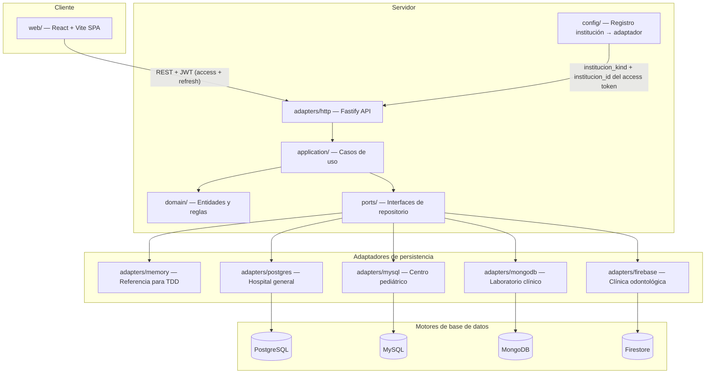

# Arquitectura — Genki Health

Plataforma compartida de historiales clínicos para cuatro instituciones médicas independientes. Proyecto final de Bases de Datos II, Universidad Rafael Landívar. Integrantes: Carlos Hugo Escobar Gómez y Héctor Jordin Adolfo García Coyoy.

## Estado actual (Entrega II — base P0 + Auth)

El repositorio tiene el esqueleto cliente-servidor (npm workspaces) traído desde PR #9 rebaseado sobre `main` (con #8 ya fusionado). E2-P0-01 levantó la regla obsoleta “solo Entrega I” en `AGENTS.md`, añadió `docs/gate-checklist.md` (G0–G8), el índice `docs/plan/E2-EXECUTABLE.md` y el contrato congelado `docs/plan/contracts/CORE.md`. E2-P1-01 añade el pack de protocolo C2/C3 (`API.md`, `PORTS-TESTS.md`, `DTO-BASELINE.ts`, versión `e2-mvp-2026-11-05`) sin implementar aún los métodos TypeScript. E2-P1-02 congela el esquema físico SQL C4a/C4b (`docs/plan/ddl/postgres.sql`, `docs/plan/ddl/mysql.sql`, `docs/plan/contracts/SQL.md`) como especificaciones; no son migraciones ejecutadas ni adaptadores de motor. E2-P1-03 congela C5 documentos/seguridad/semillas (`docs/plan/contracts/DOCUMENTS-SECURITY.md`, `mongodb-schema.json`) y los ADR de mapeo 0003–0005; no implementa adaptadores Mongo/Firestore ni ejecuta seeds. E2-P1-04 instala el registro ejecutable `docs/plan/tickets/index.json` (46 tickets, dependencias, `created_by`) y completa `docs/plan/E2-EXECUTABLE.md` con supuestos A1–A15, ventanas de calendario y enlaces a contratos/gates; no añade código de producto. E2-P2-01 añade DTOs MVP en `@genki/shared` (`shared/src/mvp.ts`), schemas Zod estrictos (`server/src/adapters/http/schemas.ts`), `ClinicalError` de dominio y puertos nuevos `ClinicalContext` / `CatalogoRepositoryPort` / `IdentityStorePort` / `AdapterResource`; no cablea rutas clínicas nuevas ni migra `AdapterSet`/repositorios existentes. E2-P2-02 congela la suite C3.4 de adaptadores (`server/test/contracts/clinical.contract.ts`, 17 casos con fallos de rollback nativo) detrás de `CONTRACT_RED=1` / `CONTRACT_READY=1` en `server/vitest.config.ts`; `validate` excluye la suite y el job CI `contract-red` (`npm run test:contract-red`) la reporta como expected-red hasta P2-06. E2-P2-03 da a memory transacciones aisladas reales (`MemoryInstitutionState` + UoW con mutex/ALS/clone-publish) y cachea un `AdapterSet` por kind+institutionId en el registry; `resolve` solo acepta el emparejamiento fijo kind/id 1–4 y los pares de prueba viven en `createTestMemoryAdapterSet` (fuera de `main`/`createPhase0Registry`); no completa aún guardians/search/consulta ni pone verde la suite CONTRACT_RED. Auth quedó locked por Carlos (2026-10-19): email+password, JWT completo, Argon2id, access+refresh. E1-05 sigue en paralelo y no bloquea E2.

| Componente | Estado | Ubicación |
| --- | --- | --- |
| Análisis clínico (58 entidades, atributos, clasificación, operaciones) | Completo | `docs/entregas/entrega-1/analisis-y-modelo-relacional.md` |
| Modelo ER (Hospital general, Centro pediátrico) | Completo | `docs/entregas/entrega-1/diagramas/er-*.mmd` |
| Modelo relacional (secciones 7.4 y 7.5) | Completo | `docs/entregas/entrega-1/diagramas/rel-*.mmd` |
| Diagramas Chen detallados (sección 6.4) | Parcial (E1-03/E1-05 pueden seguir abiertos) | `docs/entregas/entrega-1/diagramas/chen-6.4.*` |
| Monorepo TypeScript (Fastify + React/Vite) | Scaffold on `main` (E2-01 via PR #10) | `server/`, `web/`, `shared/` |
| Puertos hexagonales + adaptador memory | Live reference base for TDD | `server/src/ports`, `server/src/adapters/memory` |
| Auth / JWT / sesión | Locked + implementado (memory SoR) | `server/src/ports/auth.ts`, `adapters/memory/auth.ts` |
| Motores reales (pg/mysql/mongo/firebase) | Pendiente / incomplete | carpetas vacías bajo `server/src/adapters/` |
| `scripts/validate.sh` + CI | G1 base gate on `main` (E2-P0-03) | `scripts/validate.sh`, `scripts/journal-gate.mjs`, `.github/workflows/ci.yml` |
| Contratos HTTP/puertos/DTO (C2/C3) | Congelados (E2-P1-01); tipos/schemas/runtime parcial (E2-P2-01); suite adaptadores C3.4 congelada opt-in (E2-P2-02); memory UoW/registry C3.2/C3.3 (E2-P2-03) | `docs/plan/contracts/API.md`, `PORTS-TESTS.md`, `DTO-BASELINE.ts`, `shared/src/mvp.ts`, `server/src/adapters/http/schemas.ts`, `server/src/domain/clinical-error.ts`, `server/test/contracts/`, `server/src/adapters/memory/state.ts`, `server/src/config/adapter-registry.ts` |
| Esquema físico SQL (C4a/C4b) | Congelado (E2-P1-02); ejecución en adaptadores pendiente | `docs/plan/ddl/postgres.sql`, `docs/plan/ddl/mysql.sql`, `docs/plan/contracts/SQL.md` |
| Documentos/seguridad/semillas (C5) + ADR 0003–0005 | Congelado (E2-P1-03); adaptadores/roles/seeds pendientes | `docs/plan/contracts/DOCUMENTS-SECURITY.md`, `mongodb-schema.json`, `docs/specs/adr/ADR-0003-mongodb-aggregates.md`, `ADR-0004-firestore-aggregates.md`, `ADR-0005-security-and-transactions.md` |
| Índice ejecutable de tickets + checklist de gates | Instalado (E2-P1-04); comportamiento de producto pendiente | `docs/plan/tickets/index.json`, `docs/plan/E2-EXECUTABLE.md`, `docs/gate-checklist.md`, `scripts/test/plan-paths.test.mjs` |

### Matriz de adaptadores (incompleta)

| Path | Institución | Estado |
| --- | --- | --- |
| `adapters/memory` | las cuatro (referencia de pruebas) | activo |
| `adapters/postgres` | Hospital general | pendiente |
| `adapters/mysql` | Centro médico pediátrico | pendiente |
| `adapters/mongodb` | Laboratorio clínico | pendiente |
| `adapters/firebase` | Clínica odontológica | pendiente |

## Instituciones y motores

Cada institución usa un motor distinto. La asignación está fijada en `poteto-mode/decisions/locked.md` y en `@genki/shared` (`INSTITUTION_ENGINE_ASSIGNMENTS`).

| Institución | Motor | Qué modela la Entrega I |
| --- | --- | --- |
| Hospital general | PostgreSQL | ER completo + modelo relacional |
| Centro médico pediátrico | MySQL | ER completo + modelo relacional |
| Laboratorio clínico | MongoDB | Entidades, atributos, clasificación, operaciones |
| Clínica odontológica | Firebase (Firestore) | Entidades, atributos, clasificación, operaciones |

## Comportamiento del sistema (diseño aprobado)

La especificación completa está en `docs/superpowers/specs/2026-08-27-genki-health-architecture-and-agent-governance-design.md`. Resumen:

1. **Un expediente por paciente por institución.** El historial se acumula; no se borran filas clínicas. La baja es `estado = archivado` con motivo.
2. **Enrutamiento por institución.** Al autenticarse, el JWT lleva `institucion_id`, `institucion_kind` y `motor`; el middleware resuelve el conjunto de adaptadores.
3. **Arquitectura hexagonal.** La lógica de negocio no depende del motor. Los casos de uso reciben puertos; los adaptadores implementan cada motor.
4. **Sin ORM.** Drivers directos (`pg`, `mysql2`, `mongodb`, `firebase-admin`) con SQL y migraciones escritas a mano.
5. **Interfaz idéntica.** El cliente web (React + Vite) consume una API REST; la UI no cambia según el motor activo.
6. **Facturación simulada.** Quetzales con 12% IVA. No hay conexión a autoridad tributaria.
7. **Clasificación de datos.** Público, confidencial y restringido según la sección 9 del documento de Entrega I.

## Módulos y flujo de datos

### Flujo de autenticación (locked 2026-10-19)

1. `POST /api/auth/login` con `email`, `password`, `institution_kind` → Argon2id verify → access JWT (30m) + refresh JWT (14d).
2. Claims de access: `sub`, `email`, `institucion_id`, `institucion_kind`, `roles`, `motor`, `iat`, `exp`, `typ:"access"`.
3. Rutas clínicas (p. ej. `POST /api/pacientes`) exigen `Authorization: Bearer <access>`; el middleware resuelve el registro.
4. `POST /api/auth/refresh` rota el refresh (`jti` anterior invalidado).
5. Identidad: `AuthPort` de plataforma (memory ahora; Hospital PostgreSQL después). No es por-adaptador clínico.

## Módulos del dominio clínico

| Módulo | Entidades principales | Archivo relacional |
| --- | --- | --- |
| Acceso y auditoría | Institución, usuario, rol, bitácora | `rel-acceso.mmd` |
| Paciente y expediente | Paciente, expediente, contacto de emergencia | `rel-paciente-expediente.mmd` |
| Atención clínica | Cita, consulta, diagnóstico, tratamiento, receta | `rel-atencion.mmd` |
| Hospitalización | Cama, servicio, nota de evolución, procedimiento | `rel-hospitalizacion.mmd` |
| Facturación | Tarifario, factura, pago | `rel-facturacion.mmd` |
| Personal e insumos | Profesional, honorario, insumo, cargo | `rel-personal-insumos.mmd` |
| Extensiones pediátricas | Responsable, antecedente perinatal, crecimiento, vacunación | `rel-pediatrico.mmd` |

## Infraestructura

| Componente | Propósito |
| --- | --- |
| `infra/docker-compose.yml` | PostgreSQL, MySQL, MongoDB en desarrollo y CI |
| `infra/firebase/` | Configuración del emulador Firebase |
| `scripts/validate.sh` | Compuerta local que replica CI (incluye `test:protocol` y journal gate) |
| `scripts/journal-gate.mjs` | Exige journal *añadido* si el diff toca `server/`/`web/`/`shared/` |
| `.github/workflows/ci.yml` | Job `validate` (Node 22, `npm ci`); nombre estable; `fetch-depth: 0` |
| `.env.example` | Variables locales (sin secretos) |

## Mantenimiento

Los agentes deben actualizar este documento cuando un PR cambie el comportamiento de la aplicación.
