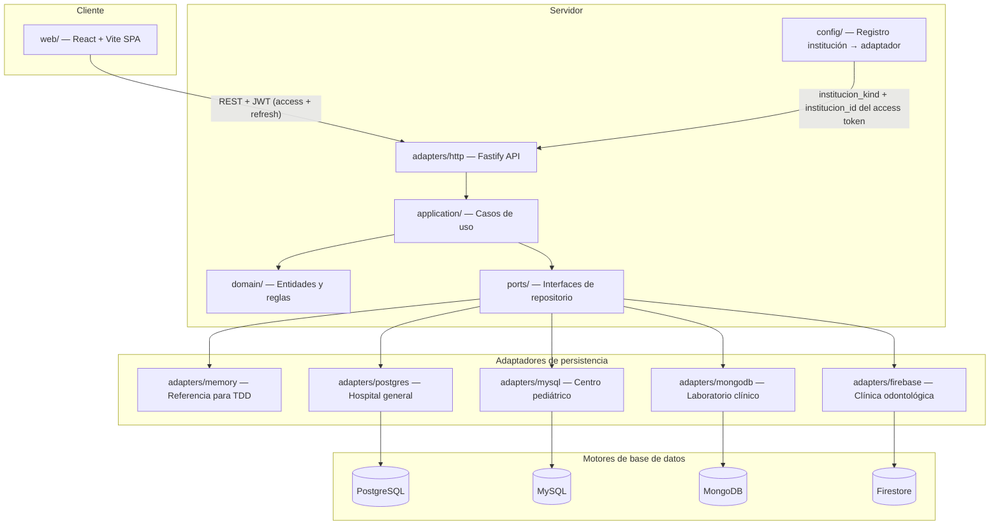

# Arquitectura — Genki Health

Plataforma compartida de historiales clínicos para cuatro instituciones médicas independientes. Proyecto final de Bases de Datos II, Universidad Rafael Landívar. Integrantes: Carlos Hugo Escobar Gómez y Héctor Jordin Adolfo García Coyoy.

## Estado actual (Entrega II — base P0 + Auth)

El repositorio tiene el esqueleto cliente-servidor (npm workspaces) traído desde PR #9 rebaseado sobre `main` (con #8 ya fusionado). E2-P0-01 levantó la regla obsoleta “solo Entrega I” en `AGENTS.md`, añadió `docs/gate-checklist.md` (G0–G8), el índice `docs/plan/E2-EXECUTABLE.md` y el contrato congelado `docs/plan/contracts/CORE.md`. Auth quedó locked por Carlos (2026-10-19): email+password, JWT completo, Argon2id, access+refresh. E1-05 sigue en paralelo y no bloquea E2.

| Componente | Estado | Ubicación |
| --- | --- | --- |
| Análisis clínico (58 entidades, atributos, clasificación, operaciones) | Completo | `docs/entregas/entrega-1/analisis-y-modelo-relacional.md` |
| Modelo ER (Hospital general, Centro pediátrico) | Completo | `docs/entregas/entrega-1/diagramas/er-*.mmd` |
| Modelo relacional (secciones 7.4 y 7.5) | Completo | `docs/entregas/entrega-1/diagramas/rel-*.mmd` |
| Diagramas Chen detallados (sección 6.4) | Parcial (E1-03/E1-05 pueden seguir abiertos) | `docs/entregas/entrega-1/diagramas/chen-6.4.*` |
| Monorepo TypeScript (Fastify + React/Vite) | Scaffold on `main` (E2-01 via PR #10) | `server/`, `web/`, `shared/` |
| Puertos hexagonales + adaptador memory | Live reference base for TDD | `server/src/ports`, `server/src/adapters/memory` |
| Auth / JWT / sesión | Locked + implementado (memory SoR) | `server/src/ports/auth.ts`, `adapters/memory/auth.ts` |
| Motores reales (pg/mysql/mongo/firebase) | Pendiente / incomplete | carpetas vacías bajo `server/src/adapters/` |
| `scripts/validate.sh` + CI | Scaffold on `main` | `scripts/validate.sh`, `.github/workflows/ci.yml` |

### Matriz de adaptadores (incompleta)

| Path | Institución | Estado |
| --- | --- | --- |
| `adapters/memory` | las cuatro (referencia de pruebas) | activo |
| `adapters/postgres` | Hospital general | pendiente |
| `adapters/mysql` | Centro médico pediátrico | pendiente |
| `adapters/mongodb` | Laboratorio clínico | pendiente |
| `adapters/firebase` | Clínica odontológica | pendiente |

## Instituciones y motores

Cada institución usa un motor distinto. La asignación está fijada en `poteto-mode/decisions/locked.md` y en `@genki/shared` (`INSTITUTION_ENGINE_ASSIGNMENTS`).

| Institución | Motor | Qué modela la Entrega I |
| --- | --- | --- |
| Hospital general | PostgreSQL | ER completo + modelo relacional |
| Centro médico pediátrico | MySQL | ER completo + modelo relacional |
| Laboratorio clínico | MongoDB | Entidades, atributos, clasificación, operaciones |
| Clínica odontológica | Firebase (Firestore) | Entidades, atributos, clasificación, operaciones |

## Comportamiento del sistema (diseño aprobado)

La especificación completa está en `docs/superpowers/specs/2026-08-27-genki-health-architecture-and-agent-governance-design.md`. Resumen:

1. **Un expediente por paciente por institución.** El historial se acumula; no se borran filas clínicas. La baja es `estado = archivado` con motivo.
2. **Enrutamiento por institución.** Al autenticarse, el JWT lleva `institucion_id`, `institucion_kind` y `motor`; el middleware resuelve el conjunto de adaptadores.
3. **Arquitectura hexagonal.** La lógica de negocio no depende del motor. Los casos de uso reciben puertos; los adaptadores implementan cada motor.
4. **Sin ORM.** Drivers directos (`pg`, `mysql2`, `mongodb`, `firebase-admin`) con SQL y migraciones escritas a mano.
5. **Interfaz idéntica.** El cliente web (React + Vite) consume una API REST; la UI no cambia según el motor activo.
6. **Facturación simulada.** Quetzales con 12% IVA. No hay conexión a autoridad tributaria.
7. **Clasificación de datos.** Público, confidencial y restringido según la sección 9 del documento de Entrega I.

## Módulos y flujo de datos

### Flujo de autenticación (locked 2026-10-19)

1. `POST /api/auth/login` con `email`, `password`, `institution_kind` → Argon2id verify → access JWT (30m) + refresh JWT (14d).
2. Claims de access: `sub`, `email`, `institucion_id`, `institucion_kind`, `roles`, `motor`, `iat`, `exp`, `typ:"access"`.
3. Rutas clínicas (p. ej. `POST /api/pacientes`) exigen `Authorization: Bearer <access>`; el middleware resuelve el registro.
4. `POST /api/auth/refresh` rota el refresh (`jti` anterior invalidado).
5. Identidad: `AuthPort` de plataforma (memory ahora; Hospital PostgreSQL después). No es por-adaptador clínico.

## Módulos del dominio clínico

| Módulo | Entidades principales | Archivo relacional |
| --- | --- | --- |
| Acceso y auditoría | Institución, usuario, rol, bitácora | `rel-acceso.mmd` |
| Paciente y expediente | Paciente, expediente, contacto de emergencia | `rel-paciente-expediente.mmd` |
| Atención clínica | Cita, consulta, diagnóstico, tratamiento, receta | `rel-atencion.mmd` |
| Hospitalización | Cama, servicio, nota de evolución, procedimiento | `rel-hospitalizacion.mmd` |
| Facturación | Tarifario, factura, pago | `rel-facturacion.mmd` |
| Personal e insumos | Profesional, honorario, insumo, cargo | `rel-personal-insumos.mmd` |
| Extensiones pediátricas | Responsable, antecedente perinatal, crecimiento, vacunación | `rel-pediatrico.mmd` |

## Infraestructura

| Componente | Propósito |
| --- | --- |
| `infra/docker-compose.yml` | PostgreSQL, MySQL, MongoDB en desarrollo y CI |
| `infra/firebase/` | Configuración del emulador Firebase |
| `scripts/validate.sh` | Compuerta local que replica CI |
| `.github/workflows/ci.yml` | Checks requeridos en cada PR |
| `.env.example` | Variables locales (sin secretos) |

## Mantenimiento

Los agentes deben actualizar este documento cuando un PR cambie el comportamiento de la aplicación.
