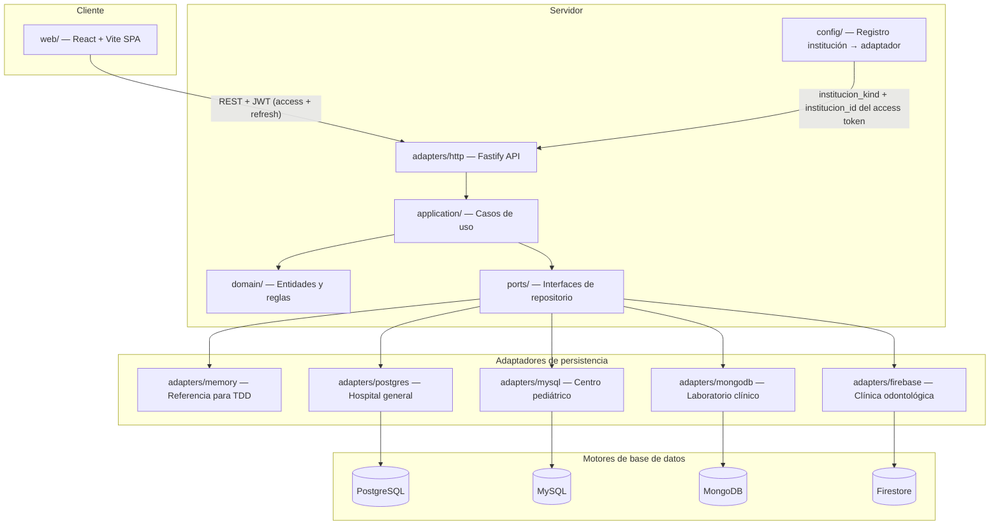

# Arquitectura — Genki Health

Plataforma compartida de historiales clínicos para cuatro instituciones médicas independientes. Proyecto final de Bases de Datos II, Universidad Rafael Landívar. Integrantes: Carlos Hugo Escobar Gómez y Héctor Jordin Adolfo García Coyoy.

## Estado actual (Entrega II — base P0 + Auth)

El repositorio tiene el esqueleto cliente-servidor (npm workspaces) traído desde PR #9 rebaseado sobre `main` (con #8 ya fusionado). E2-P0-01 levantó la regla obsoleta “solo Entrega I” en `AGENTS.md`, añadió `docs/gate-checklist.md` (G0–G8), el índice `docs/plan/E2-EXECUTABLE.md` y el contrato congelado `docs/plan/contracts/CORE.md`. E2-P1-01 añade el pack de protocolo C2/C3 (`API.md`, `PORTS-TESTS.md`, `DTO-BASELINE.ts`, versión `e2-mvp-2026-11-05`) sin implementar aún los métodos TypeScript. E2-P1-02 congela el esquema físico SQL C4a/C4b (`docs/plan/ddl/postgres.sql`, `docs/plan/ddl/mysql.sql`, `docs/plan/contracts/SQL.md`) como especificaciones; no son migraciones ejecutadas ni adaptadores de motor. E2-P1-03 congela C5 documentos/seguridad/semillas (`docs/plan/contracts/DOCUMENTS-SECURITY.md`, `mongodb-schema.json`) y los ADR de mapeo 0003–0005; no implementa adaptadores Mongo/Firestore ni ejecuta seeds. E2-P1-04 instala el registro ejecutable `docs/plan/tickets/index.json` (46 tickets, dependencias, `created_by`) y completa `docs/plan/E2-EXECUTABLE.md` con supuestos A1–A15, ventanas de calendario y enlaces a contratos/gates; no añade código de producto. E2-P2-01 añade DTOs MVP en `@genki/shared` (`shared/src/mvp.ts`), schemas Zod estrictos (`server/src/adapters/http/schemas.ts`), `ClinicalError` de dominio y puertos nuevos `ClinicalContext` / `CatalogoRepositoryPort` / `IdentityStorePort` / `AdapterResource`; no cablea rutas clínicas nuevas ni migra `AdapterSet`/repositorios existentes. E2-P2-02 congela la suite C3.4 de adaptadores (`server/test/contracts/clinical.contract.ts`, 17 casos con fallos de rollback nativo) detrás de `CONTRACT_RED=1` / `CONTRACT_READY=1` en `server/vitest.config.ts`; `validate` excluye la suite y el job CI `contract-red` (`npm run test:contract-red`) la reporta como expected-red hasta P2-06. E2-P2-03 da a memory transacciones aisladas reales (`MemoryInstitutionState` + UoW con mutex/ALS/clone-publish) y cachea un `AdapterSet` por kind+institutionId en el registry; `resolve` solo acepta el emparejamiento fijo kind/id 1–4 y los pares de prueba viven en `createTestMemoryAdapterSet` (fuera de `main`/`createPhase0Registry`). E2-P2-04 completa en memory el alta atómica de paciente y expediente, los responsables cuando el kind es `centro_pediatrico`, la búsqueda por documento, número de expediente o nombre, y el archivo del expediente. `registerPaciente` y `archiveExpediente` lanzan `ClinicalError`. Archivar no escribe `archivado` en `paciente.estado`. `MemoryCatalogoRepository` lee municipios, profesionales activos y medicamentos activos del estado de la institución. E2-P2-05 añade `validateConsulta` en `server/src/domain/consulta.ts` (invariantes estructurales C1.2 del paquete diagnóstico/tratamiento/receta, más techo inclusivo de 256 KiB UTF-8 sobre `JSON.stringify` → `invalid_bundle`). E2-P2-06 implementa el agregado memory de consulta cerrada (`MemoryConsultaRepository`), el caso de uso `closeConsulta`, el puente TEST-ONLY del harness (CCR-HARNESS-001), secuencias compartidas por dominio memory simulado y ALS acotado al estado de la institución; la suite C3.4 memory queda 17/17 verde en `npm test` por defecto (sin `CONTRACT_RED`). E2-P2-07 expone por HTTP la búsqueda de pacientes (`GET /api/pacientes`), el historial (`GET /api/pacientes/:id`), catálogos (`GET /api/catalogos`) y archivo (`POST /api/pacientes/:id/archivo`), con `listPacientes` / `getHistorial`, mapper seguro `toErrorDto`, envelope 404 congelado y matriz de roles lectura vs registro/archivo. E2-P2-08 cablea `POST /api/pacientes/:id/consultas` al caso de uso `closeConsulta` (schema `closeSchema`, roles `administrador|medico`, 201 `ConsultaCompleta`, errores mapeados; recepción queda en 403). E2-P2-10 cierra el gate memory con isolation HTTP (`server/src/adapters/http/isolation.test.ts`: conjuntos memory disjuntos por institución, rechazo de motor/kind forjados, archive+read sobre la misma instancia de registry, denegación rol/cross-institución) y cobertura v8 ≥80% líneas en `domain/` + `application/` (medido ~98%). E2-P3A-01 provisiona motores locales deterministas: Compose con binds `127.0.0.1` y secretos por env, Mongo autenticado rs0 (`infra/mongodb/start-rs.sh`), `scripts/demo-env.sh`, `db:migrate` / `db:bootstrap` / `db:reset:test` (guard `genki_test_`), y Vitest carga el `.env` de la raíz sin sobreescribir env de CI. Auth quedó locked por Carlos (2026-10-19): email+password, JWT completo, Argon2id, access+refresh. E1-05 sigue en paralelo y no bloquea E2.

| Componente | Estado | Ubicación |
| --- | --- | --- |
| Análisis clínico (58 entidades, atributos, clasificación, operaciones) | Completo | `docs/entregas/entrega-1/analisis-y-modelo-relacional.md` |
| Modelo ER (Hospital general, Centro pediátrico) | Completo | `docs/entregas/entrega-1/diagramas/er-*.mmd` |
| Modelo relacional (secciones 7.4 y 7.5) | Completo | `docs/entregas/entrega-1/diagramas/rel-*.mmd` |
| Diagramas Chen detallados (sección 6.4) | Parcial (E1-03/E1-05 pueden seguir abiertos) | `docs/entregas/entrega-1/diagramas/chen-6.4.*` |
| Monorepo TypeScript (Fastify + React/Vite) | Scaffold on `main` (E2-01 via PR #10) | `server/`, `web/`, `shared/` |
| Puertos hexagonales + adaptador memory | Live reference base for TDD | `server/src/ports`, `server/src/adapters/memory` |
| Auth / JWT / sesión | Locked + JWT service + IdentityStorePort (memory SoR) | `server/src/ports/auth.ts`, `adapters/auth/service.ts`, `adapters/memory/auth.ts` (`MemoryIdentityStore`) |
| Motores reales (pg/mysql/mongo/firebase) | Infra local lista (E2-P3A-01); adaptadores aún pendientes | `infra/docker-compose.yml`, `scripts/demo-env.sh`, `scripts/db-*.ts`; carpetas adaptador aún vacías |
| `scripts/validate.sh` + CI | G1 base gate on `main` (E2-P0-03) | `scripts/validate.sh`, `scripts/journal-gate.mjs`, `.github/workflows/ci.yml` |
| Contratos HTTP/puertos/DTO (C2/C3) | Congelados (E2-P1-01); tipos/schemas/runtime parcial (E2-P2-01); suite adaptadores C3.4 memory verde (E2-P2-02…E2-P2-06); memory UoW/registry (E2-P2-03); alta/búsqueda/archivo (E2-P2-04); invariantes de consulta (E2-P2-05); consulta cerrada memory + bridge TEST-ONLY (E2-P2-06); HTTP search/detail/catalog/archive (E2-P2-07); HTTP cierre atómico de consulta (E2-P2-08); isolation HTTP + coverage≥80% domain/application (E2-P2-10) | `docs/plan/contracts/API.md`, `PORTS-TESTS.md`, `DTO-BASELINE.ts`, `shared/src/mvp.ts`, `server/src/adapters/http/schemas.ts`, `server/src/adapters/http/errors.ts`, `server/src/adapters/http/app.ts`, `server/src/adapters/http/isolation.test.ts`, `server/vitest.config.ts`, `server/src/domain/clinical-error.ts`, `server/src/domain/consulta.ts`, `server/src/application/list-pacientes.ts`, `server/src/application/get-historial.ts`, `server/src/application/close-consulta.ts`, `server/test/contracts/`, `server/src/adapters/memory/state.ts`, `server/src/adapters/memory/paciente-repository.ts`, `server/src/adapters/memory/consulta-repository.ts`, `server/src/adapters/memory/catalogo-repository.ts`, `server/src/config/adapter-registry.ts`, `server/src/testing/memory-harness.ts` |
| Esquema físico SQL (C4a/C4b) | Congelado (E2-P1-02); ejecución en adaptadores pendiente | `docs/plan/ddl/postgres.sql`, `docs/plan/ddl/mysql.sql`, `docs/plan/contracts/SQL.md` |
| Documentos/seguridad/semillas (C5) + ADR 0003–0005 | Congelado (E2-P1-03); adaptadores/roles/seeds pendientes | `docs/plan/contracts/DOCUMENTS-SECURITY.md`, `mongodb-schema.json`, `docs/specs/adr/ADR-0003-mongodb-aggregates.md`, `ADR-0004-firestore-aggregates.md`, `ADR-0005-security-and-transactions.md` |
| Índice ejecutable de tickets + checklist de gates | Instalado (E2-P1-04); comportamiento de producto pendiente | `docs/plan/tickets/index.json`, `docs/plan/E2-EXECUTABLE.md`, `docs/gate-checklist.md`, `scripts/test/plan-paths.test.mjs` |

### Matriz de adaptadores (incompleta)

| Path | Institución | Estado |
| --- | --- | --- |
| `adapters/memory` | las cuatro (referencia de pruebas) | activo |
| `adapters/postgres` | Hospital general | pendiente |
| `adapters/mysql` | Centro médico pediátrico | pendiente |
| `adapters/mongodb` | Laboratorio clínico | pendiente |
| `adapters/firebase` | Clínica odontológica | pendiente |

## Instituciones y motores

Cada institución usa un motor distinto. La asignación está fijada en `poteto-mode/decisions/locked.md` y en `@genki/shared` (`INSTITUTION_ENGINE_ASSIGNMENTS`).

| Institución | Motor | Qué modela la Entrega I |
| --- | --- | --- |
| Hospital general | PostgreSQL | ER completo + modelo relacional |
| Centro médico pediátrico | MySQL | ER completo + modelo relacional |
| Laboratorio clínico | MongoDB | Entidades, atributos, clasificación, operaciones |
| Clínica odontológica | Firebase (Firestore) | Entidades, atributos, clasificación, operaciones |

## Comportamiento del sistema (diseño aprobado)

La especificación completa está en `docs/superpowers/specs/2026-08-27-genki-health-architecture-and-agent-governance-design.md`. Resumen:

1. **Un expediente por paciente por institución.** El historial se acumula; no se borran filas clínicas. La baja es `estado = archivado` con motivo.
2. **Enrutamiento por institución.** Al autenticarse, el JWT lleva `institucion_id`, `institucion_kind` y `motor`; el middleware resuelve el conjunto de adaptadores.
3. **Arquitectura hexagonal.** La lógica de negocio no depende del motor. Los casos de uso reciben puertos; los adaptadores implementan cada motor.
4. **Sin ORM.** Drivers directos (`pg`, `mysql2`, `mongodb`, `firebase-admin`) con SQL y migraciones escritas a mano.
5. **Interfaz idéntica.** El cliente web (React + Vite) consume una API REST; la UI no cambia según el motor activo.
6. **Facturación simulada.** Quetzales con 12% IVA. No hay conexión a autoridad tributaria.
7. **Clasificación de datos.** Público, confidencial y restringido según la sección 9 del documento de Entrega I.

## Módulos y flujo de datos

### Flujo de autenticación (locked 2026-10-19; E2-P2-09)

1. `POST /api/auth/login` con `email`, `password`, `institution_kind` → `IdentityStorePort.findUser` → Argon2id verify → access JWT (30m) + refresh JWT (14d). El refresh `jti` se persiste como `SHA-256(jti)` vía `insertRefresh`.
2. Claims de access: `sub`, `email`, `institucion_id`, `institucion_kind`, `roles`, `motor`, `iat`, `exp`, `typ:"access"`. Verify usa `algorithms: ['HS256']`, pares kind/id 1–4, y `estado === 'activo'`.
3. Rutas clínicas (p. ej. `POST /api/pacientes`) exigen `Authorization: Bearer <access>`; el middleware resuelve el registro.
4. `POST /api/auth/refresh` rota con `rotateRefresh` (un ganador); replay o perdedor concurrente → `invalid_token`.
5. `POST /api/auth/logout` (sin bearer) revoca el refresh; el access ya emitido sigue válido hasta `exp` (C1 / A12).
6. Identidad: `createAuthService` (storage-neutral) sobre `IdentityStorePort`. Memory SoR ahora; Hospital PostgreSQL en E2-P3A-05. No es por-adaptador clínico.
7. Statechart de sesión: `docs/progress/statecharts/e2-p2-09/`.

## Módulos del dominio clínico

| Módulo | Entidades principales | Archivo relacional |
| --- | --- | --- |
| Acceso y auditoría | Institución, usuario, rol, bitácora | `rel-acceso.mmd` |
| Paciente y expediente | Paciente, expediente, contacto de emergencia | `rel-paciente-expediente.mmd` |
| Atención clínica | Cita, consulta, diagnóstico, tratamiento, receta | `rel-atencion.mmd` |
| Hospitalización | Cama, servicio, nota de evolución, procedimiento | `rel-hospitalizacion.mmd` |
| Facturación | Tarifario, factura, pago | `rel-facturacion.mmd` |
| Personal e insumos | Profesional, honorario, insumo, cargo | `rel-personal-insumos.mmd` |
| Extensiones pediátricas | Responsable, antecedente perinatal, crecimiento, vacunación | `rel-pediatrico.mmd` |

## Infraestructura

| Componente | Propósito |
| --- | --- |
| `infra/docker-compose.yml` | PostgreSQL, MySQL, MongoDB en desarrollo y CI |
| `infra/firebase/` | Configuración del emulador Firebase |
| `scripts/validate.sh` | Compuerta local que replica CI (incluye `test:protocol` y journal gate) |
| `scripts/journal-gate.mjs` | Exige journal *añadido* si el diff toca `server/`/`web/`/`shared/` |
| `.github/workflows/ci.yml` | Job `validate` (Node 22, `npm ci`); nombre estable; `fetch-depth: 0` |
| `.env.example` | Variables locales (sin secretos) |

## Mantenimiento

Los agentes deben actualizar este documento cuando un PR cambie el comportamiento de la aplicación.

## E2-P5-03 — interfaz compartida (2026-11-08)

React usa History API para las cinco rutas C1.3. Login inicia con correo y contraseña vacíos; el cliente adjunta bearer, serializa la renovación y reintenta una sola vez ante 401. Logout solicita revocación y limpia la sesión aun si falla la red. La búsqueda permite documento/expediente/nombre, estado y páginas de 20. Registro envía solo campos C2 y captura de 1 a 5 responsables con un único principal en Pediatría. Consulta `/api/catalogos` para municipios; no inventa catálogos. Éxito navega a ficha, cuya pantalla y la de consulta indican explícitamente que esperan E2-P5-04.

El servidor de esta base PR49 sigue usando memoria. La interfaz lo advierte y no acredita persistencia nativa. Los catálogos del arranque por defecto están vacíos; los usuarios predeterminados no hospitalarios no tienen permiso de registro. No se modificaron roles, backend ni contratos. La comprobación manual de navegador quedó bloqueada por fallos de las herramientas del escritorio; las pruebas web y una comprobación HTTP de memoria sí pasaron.

## E2-P5-04 — ficha y atención clínica compartidas

La ficha ahora muestra todos los campos de paciente/expediente y el historial de consultas en orden descendente, con diagnósticos, tratamientos, receta y detalles expandibles. Las fechas/hora se muestran en America/Guatemala. La consulta captura profesional del catálogo, diagnósticos con un principal, tratamientos vinculados y receta opcional con medicamentos del catálogo. Envía una sola solicitud C2 de cierre completo; no guarda etapas parciales.

El diálogo de archivo exige motivo y confirmación, envía solamente motivo/observación y refresca la ficha. Un expediente archivado oculta acciones de mutación. Se respetan los roles de la sesión, sin cambios al backend ni permisos. Los errores mantienen los formularios; una carrera de archivo devuelve a ficha con explicación y conserva el borrador en memoria del componente, consultable mientras se permanezca en ese paciente. Recargar, salir del paciente o cerrar sesión descarta ese borrador; no se persiste en almacenamiento del navegador. Se conserva el panel único de módulos diferidos y la advertencia de servidor en memoria. La consulta de Laboratorio se etiqueta como extensión académica, no flujo de exámenes.

La base todavía arranca con catálogos vacíos; sin profesional no puede guardarse una consulta y sin medicamentos no puede incluirse receta. La UI no inventa opciones ni acredita persistencia física.
