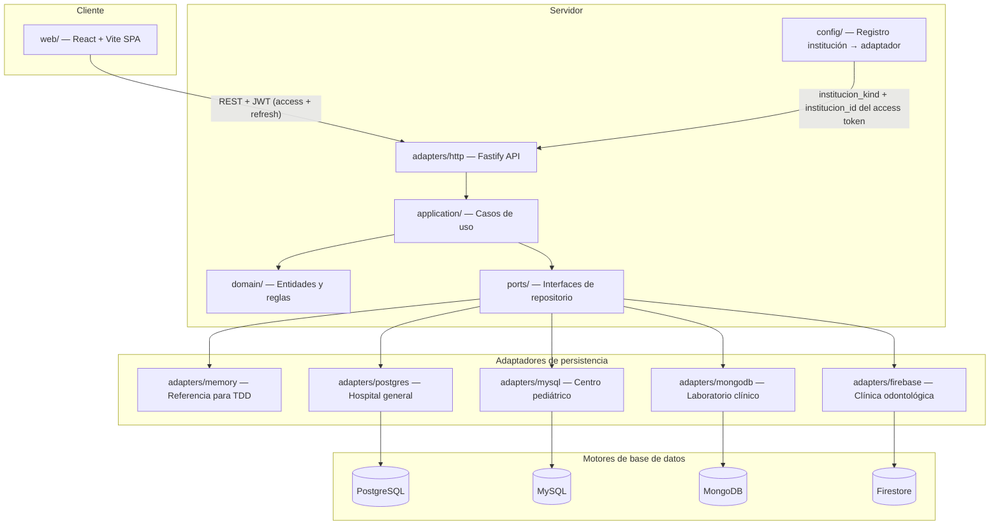

# Arquitectura — Genki Health

Plataforma compartida de historiales clínicos para cuatro instituciones médicas independientes. Proyecto final de Bases de Datos II, Universidad Rafael Landívar. Integrantes: Carlos Hugo Escobar Gómez y Héctor Jordin Adolfo García Coyoy.

## Lane-3 account / users / reactivación (2026-11-09)

Hospital PG identity SoR mounts OP-03 `POST /api/auth/password` and OP-04 `POST /api/usuarios/:id/reset-password` (account) plus OP-05 `POST /api/usuarios` and OP-06 `GET /api/bitacora` (users). Domain checks use central `assertRoles` (superadministrador bypass). OP-19 `POST /api/pacientes/:id/reactivacion` reactivates archived expedientes on all four engines without erasing history. UI: `/cuenta`, `/usuarios`, Historial reactivar. `db:setup:all` runs `server/test/full/lane3/manage.ts` idempotently (PG/MySQL migrations, Mongo index, Firestore ensure) and honors `FIRESTORE_MODE=real`.

## Lane A+B integration (2026-11-09)

Codex lanes A (caja/inventario/honorarios/facturación OP61–77) and B (agenda OP20–25) are mounted on the main Fastify app via `registerLaneABRoutes`: full `agendaPlugin` plus economic plugins resolve the selected institution's `AdapterSet.full` bag (agenda + shared EconomicStore services). Engine factories and memory attach that bag through `laneABModulesFrom`. Auth uses `requirePrincipal` and domain `assertRoles` (superadministrador bypass). UI routes: `/agenda`, `/economia`, `/inventario`, `/honorarios`, `/facturacion`, `/caja`, `/personal`. `npm run db:setup:all` still migrates/seeds charges+agenda on all four engines.

## Lane-2 specialty modules (2026-11-09)

Institution-scoped specialty ops on their assigned engines: hospitalización OP34–38 on PostgreSQL (`admission`/`procedure`/`discharge`, including OP37 `POST /api/procedimientos`); pediatría OP40–47 on MySQL; laboratorio OP48–54 on MongoDB; odontología OP55–60 on Firestore (`dental-chart`/`dental-plan`/`dental-session`, including OP59/60). HTTP mounts from `specialty-routes.ts`. UI: specialty panels plus `/procedimientos` and `/sesiones-dentales`. `db:setup:all` also runs procedure (PG) and dental-session (Firestore) manage scripts idempotently; PG `security.sql` grants `catalogo_procedimiento`/`procedimiento`.

## Lane-1 clinical shared (2026-11-09)

Additive full-system modules on the four engines for OP-12/15/16/18 (ficha, antecedentes, alergias, archivo), OP-17 (adjuntos via JSON base64 body), and OP-26/27 (abrir consulta + signos vitales). Ports live under `server/src/ports/full/{record,attachments,consultation}.ts`; adapters under `server/src/adapters/{memory,postgres,mysql,mongodb,firebase}/full/`. HTTP routes register from `server/src/adapters/http/full-routes.ts`. SQL migrations: `postgres/migrations/0004-clinical-shared.sql`, `mysql/migrations/0002-clinical-shared.sql`. Mongo validators/indexes and Firestore collection allowlist extended for the same entities. Baseline atomic close-consultation shortcut remains.

## Estado actual (Entrega II — base P0 + Auth)

El repositorio tiene el esqueleto cliente-servidor (npm workspaces) traído desde PR #9 rebaseado sobre `main` (con #8 ya fusionado). E2-P0-01 levantó la regla obsoleta “solo Entrega I” en `AGENTS.md`, añadió `docs/gate-checklist.md` (G0–G8), el índice `docs/plan/E2-EXECUTABLE.md` y el contrato congelado `docs/plan/contracts/CORE.md`. E2-P1-01 añade el pack de protocolo C2/C3 (`API.md`, `PORTS-TESTS.md`, `DTO-BASELINE.ts`, versión `e2-mvp-2026-11-05`) sin implementar aún los métodos TypeScript. E2-P1-02 congela el esquema físico SQL C4a/C4b (`docs/plan/ddl/postgres.sql`, `docs/plan/ddl/mysql.sql`, `docs/plan/contracts/SQL.md`) como especificaciones; no son migraciones ejecutadas ni adaptadores de motor. E2-P1-03 congela C5 documentos/seguridad/semillas (`docs/plan/contracts/DOCUMENTS-SECURITY.md`, `mongodb-schema.json`) y los ADR de mapeo 0003–0005; no implementa adaptadores Mongo/Firestore ni ejecuta seeds. E2-P1-04 instala el registro ejecutable `docs/plan/tickets/index.json` (46 tickets, dependencias, `created_by`) y completa `docs/plan/E2-EXECUTABLE.md` con supuestos A1–A15, ventanas de calendario y enlaces a contratos/gates; no añade código de producto. E2-P2-01 añade DTOs MVP en `@genki/shared` (`shared/src/mvp.ts`), schemas Zod estrictos (`server/src/adapters/http/schemas.ts`), `ClinicalError` de dominio y puertos nuevos `ClinicalContext` / `CatalogoRepositoryPort` / `IdentityStorePort` / `AdapterResource`; no cablea rutas clínicas nuevas ni migra `AdapterSet`/repositorios existentes. E2-P2-02 congela la suite C3.4 de adaptadores (`server/test/contracts/clinical.contract.ts`, 17 casos con fallos de rollback nativo) detrás de `CONTRACT_RED=1` / `CONTRACT_READY=1` en `server/vitest.config.ts`; `validate` excluye la suite y el job CI `contract-red` (`npm run test:contract-red`) la reporta como expected-red hasta P2-06. E2-P2-03 da a memory transacciones aisladas reales (`MemoryInstitutionState` + UoW con mutex/ALS/clone-publish) y cachea un `AdapterSet` por kind+institutionId en el registry; `resolve` solo acepta el emparejamiento fijo kind/id 1–4 y los pares de prueba viven en `createTestMemoryAdapterSet` (fuera de `main`/`createPhase0Registry`). E2-P2-04 completa en memory el alta atómica de paciente y expediente, los responsables cuando el kind es `centro_pediatrico`, la búsqueda por documento, número de expediente o nombre, y el archivo del expediente. `registerPaciente` y `archiveExpediente` lanzan `ClinicalError`. Archivar no escribe `archivado` en `paciente.estado`. `MemoryCatalogoRepository` lee municipios, profesionales activos y medicamentos activos del estado de la institución. E2-P2-05 añade `validateConsulta` en `server/src/domain/consulta.ts` (invariantes estructurales C1.2 del paquete diagnóstico/tratamiento/receta, más techo inclusivo de 256 KiB UTF-8 sobre `JSON.stringify` → `invalid_bundle`). E2-P2-06 implementa el agregado memory de consulta cerrada (`MemoryConsultaRepository`), el caso de uso `closeConsulta`, el puente TEST-ONLY del harness (CCR-HARNESS-001), secuencias compartidas por dominio memory simulado y ALS acotado al estado de la institución; la suite C3.4 memory queda 17/17 verde en `npm test` por defecto (sin `CONTRACT_RED`). E2-P3A-01 provisiona motores locales deterministas: Compose con binds `127.0.0.1` y secretos por env, Mongo autenticado rs0 (`infra/mongodb/start-rs.sh`), `scripts/demo-env.sh`, `db:migrate` / `db:bootstrap` / `db:reset:test` (guard `genki_test_`), y Vitest carga el `.env` de la raíz sin sobreescribir env de CI. E2-P3A-02 añade migraciones C4a (`0001-core` / `0002-identity` / `0003-hospital-locks`), `mapper` TIMESTAMPTZ/DATE/NUMERIC, `PostgresUnitOfWork` con ALS, `PostgresIdPort` sobre `id_counter` (`receta_folio`) y `PostgresCatalogoRepository`. E2-P3A-03 implementa `PostgresPacienteRepository` (alta atómica con `nextval` de expediente, guardianes pediátricos, búsqueda literal paginada, archivo con `FOR UPDATE` y alcance por institución) más harness Postgres de prueba; aún sin consulta cerrada ni runner de 17 casos. Auth quedó locked por Carlos (2026-10-19): email+password, JWT completo, Argon2id, access+refresh. E1-05 sigue en paralelo y no bloquea E2.
El repositorio tiene el esqueleto cliente-servidor (npm workspaces) traído desde PR #9 rebaseado sobre `main` (con #8 ya fusionado). E2-P0-01 levantó la regla obsoleta “solo Entrega I” en `AGENTS.md`, añadió `docs/gate-checklist.md` (G0–G8), el índice `docs/plan/E2-EXECUTABLE.md` y el contrato congelado `docs/plan/contracts/CORE.md`. E2-P1-01 añade el pack de protocolo C2/C3 (`API.md`, `PORTS-TESTS.md`, `DTO-BASELINE.ts`, versión `e2-mvp-2026-11-05`) sin implementar aún los métodos TypeScript. E2-P1-02 congela el esquema físico SQL C4a/C4b (`docs/plan/ddl/postgres.sql`, `docs/plan/ddl/mysql.sql`, `docs/plan/contracts/SQL.md`) como especificaciones; no son migraciones ejecutadas ni adaptadores de motor. E2-P1-03 congela C5 documentos/seguridad/semillas (`docs/plan/contracts/DOCUMENTS-SECURITY.md`, `mongodb-schema.json`) y los ADR de mapeo 0003–0005; no implementa adaptadores Mongo/Firestore ni ejecuta seeds. E2-P1-04 instala el registro ejecutable `docs/plan/tickets/index.json` (46 tickets, dependencias, `created_by`) y completa `docs/plan/E2-EXECUTABLE.md` con supuestos A1–A15, ventanas de calendario y enlaces a contratos/gates; no añade código de producto. E2-P2-01 añade DTOs MVP en `@genki/shared` (`shared/src/mvp.ts`), schemas Zod estrictos (`server/src/adapters/http/schemas.ts`), `ClinicalError` de dominio y puertos nuevos `ClinicalContext` / `CatalogoRepositoryPort` / `IdentityStorePort` / `AdapterResource`; no cablea rutas clínicas nuevas ni migra `AdapterSet`/repositorios existentes. E2-P2-02 congela la suite C3.4 de adaptadores (`server/test/contracts/clinical.contract.ts`, 17 casos con fallos de rollback nativo) detrás de `CONTRACT_RED=1` / `CONTRACT_READY=1` en `server/vitest.config.ts`; `validate` excluye la suite y el job CI `contract-red` (`npm run test:contract-red`) la reporta como expected-red hasta P2-06. E2-P2-03 da a memory transacciones aisladas reales (`MemoryInstitutionState` + UoW con mutex/ALS/clone-publish) y cachea un `AdapterSet` por kind+institutionId en el registry; `resolve` solo acepta el emparejamiento fijo kind/id 1–4 y los pares de prueba viven en `createTestMemoryAdapterSet` (fuera de `main`/`createPhase0Registry`). E2-P2-04 completa en memory el alta atómica de paciente y expediente, los responsables cuando el kind es `centro_pediatrico`, la búsqueda por documento, número de expediente o nombre, y el archivo del expediente. `registerPaciente` y `archiveExpediente` lanzan `ClinicalError`. Archivar no escribe `archivado` en `paciente.estado`. `MemoryCatalogoRepository` lee municipios, profesionales activos y medicamentos activos del estado de la institución. E2-P2-05 añade `validateConsulta` en `server/src/domain/consulta.ts` (invariantes estructurales C1.2 del paquete diagnóstico/tratamiento/receta, más techo inclusivo de 256 KiB UTF-8 sobre `JSON.stringify` → `invalid_bundle`). E2-P2-06 implementa el agregado memory de consulta cerrada (`MemoryConsultaRepository`), el caso de uso `closeConsulta`, el puente TEST-ONLY del harness (CCR-HARNESS-001), secuencias compartidas por dominio memory simulado y ALS acotado al estado de la institución; la suite C3.4 memory queda 17/17 verde en `npm test` por defecto (sin `CONTRACT_RED`). E2-P3A-01 provisiona motores locales deterministas: Compose con binds `127.0.0.1` y secretos por env, Mongo autenticado rs0 (`infra/mongodb/start-rs.sh`), `scripts/demo-env.sh`, `db:migrate` / `db:bootstrap` / `db:reset:test` (guard `genki_test_`), y Vitest carga el `.env` de la raíz sin sobreescribir env de CI. E2-P3B-01 añade la migración C4b InnoDB (`0001-core.sql`), `mapper` DATETIME/DATE/DECIMAL/BOOLEAN, `MysqlUnitOfWork` con ALS, `MysqlIdPort` sobre `id_counter` (`receta_folio`) y `MysqlCatalogoRepository`. E2-P3B-02 implementa `MysqlPacienteRepository` (alta pediátrica con responsables, búsqueda literal con `ESCAPE`, archivo con `FOR UPDATE` sin mutar `paciente.estado`, numeración `TMP-P-*`→`EXP-*` en la misma transacción) sobre MySQL disposable. E2-P3B-03 añade `MysqlConsultaRepository` (cierre atómico con bloqueo de expediente, diagnósticos/tratamientos/receta opcional, historial sin fanout) y `createMysqlAdapterSet`; la suite C3.4 mysql queda 17/17 verde bajo `TEST_ENGINES=1` en `genki_test_mysql_contract`. E2-P3B-04 instala roles `genki_app`/`genki_report` y logins env (`security.sql` + bootstrap), corre el harness clínico como app login, y prueba denegaciones nativas en `test/security/mysql.test.ts`. Auth quedó locked por Carlos (2026-10-19): email+password, JWT completo, Argon2id, access+refresh. E1-05 sigue en paralelo y no bloquea E2.
El repositorio tiene el esqueleto cliente-servidor (npm workspaces) traído desde PR #9 rebaseado sobre `main` (con #8 ya fusionado). E2-P0-01 levantó la regla obsoleta “solo Entrega I” en `AGENTS.md`, añadió `docs/gate-checklist.md` (G0–G8), el índice `docs/plan/E2-EXECUTABLE.md` y el contrato congelado `docs/plan/contracts/CORE.md`. E2-P1-01 añade el pack de protocolo C2/C3 (`API.md`, `PORTS-TESTS.md`, `DTO-BASELINE.ts`, versión `e2-mvp-2026-11-05`) sin implementar aún los métodos TypeScript. E2-P1-02 congela el esquema físico SQL C4a/C4b (`docs/plan/ddl/postgres.sql`, `docs/plan/ddl/mysql.sql`, `docs/plan/contracts/SQL.md`) como especificaciones; no son migraciones ejecutadas ni adaptadores de motor. E2-P1-03 congela C5 documentos/seguridad/semillas (`docs/plan/contracts/DOCUMENTS-SECURITY.md`, `mongodb-schema.json`) y los ADR de mapeo 0003–0005; no implementa adaptadores Mongo/Firestore ni ejecuta seeds. E2-P1-04 instala el registro ejecutable `docs/plan/tickets/index.json` (46 tickets, dependencias, `created_by`) y completa `docs/plan/E2-EXECUTABLE.md` con supuestos A1–A15, ventanas de calendario y enlaces a contratos/gates; no añade código de producto. E2-P2-01 añade DTOs MVP en `@genki/shared` (`shared/src/mvp.ts`), schemas Zod estrictos (`server/src/adapters/http/schemas.ts`), `ClinicalError` de dominio y puertos nuevos `ClinicalContext` / `CatalogoRepositoryPort` / `IdentityStorePort` / `AdapterResource`; no cablea rutas clínicas nuevas ni migra `AdapterSet`/repositorios existentes. E2-P2-02 congela la suite C3.4 de adaptadores (`server/test/contracts/clinical.contract.ts`, 17 casos con fallos de rollback nativo) detrás de `CONTRACT_RED=1` / `CONTRACT_READY=1` en `server/vitest.config.ts`; `validate` excluye la suite y el job CI `contract-red` (`npm run test:contract-red`) la reporta como expected-red hasta P2-06. E2-P2-03 da a memory transacciones aisladas reales (`MemoryInstitutionState` + UoW con mutex/ALS/clone-publish) y cachea un `AdapterSet` por kind+institutionId en el registry; `resolve` solo acepta el emparejamiento fijo kind/id 1–4 y los pares de prueba viven en `createTestMemoryAdapterSet` (fuera de `main`/`createPhase0Registry`). E2-P2-04 completa en memory el alta atómica de paciente y expediente, los responsables cuando el kind es `centro_pediatrico`, la búsqueda por documento, número de expediente o nombre, y el archivo del expediente. `registerPaciente` y `archiveExpediente` lanzan `ClinicalError`. Archivar no escribe `archivado` en `paciente.estado`. `MemoryCatalogoRepository` lee municipios, profesionales activos y medicamentos activos del estado de la institución. E2-P2-05 añade `validateConsulta` en `server/src/domain/consulta.ts` (invariantes estructurales C1.2 del paquete diagnóstico/tratamiento/receta, más techo inclusivo de 256 KiB UTF-8 sobre `JSON.stringify` → `invalid_bundle`). E2-P2-06 implementa el agregado memory de consulta cerrada (`MemoryConsultaRepository`), el caso de uso `closeConsulta`, el puente TEST-ONLY del harness (CCR-HARNESS-001), secuencias compartidas por dominio memory simulado y ALS acotado al estado de la institución; la suite C3.4 memory queda 17/17 verde en `npm test` por defecto (sin `CONTRACT_RED`). E2-P3A-01 provisiona motores locales deterministas: Compose con binds `127.0.0.1` y secretos por env, Mongo autenticado rs0 (`infra/mongodb/start-rs.sh`), `scripts/demo-env.sh`, `db:migrate` / `db:bootstrap` / `db:reset:test` (guard `genki_test_`), y Vitest carga el `.env` de la raíz sin sobreescribir env de CI. E2-P4A-01 añade validadores `$jsonSchema` estrictos, índices compuestos/parciales C5.1, helpers BSON Int32, UoW de sesión con snapshot/majority (reintentos transitorios ≤3) y catálogo Mongo en `server/src/adapters/mongodb/`. E2-P4A-02 implementa `MongoPacienteRepository` (alta atómica paciente+expediente+responsables, búsqueda literal, archivo con `_rev`) y el harness Mongo en `genki_test_mongodb_paciente`. E2-P4A-03 añade `MongoConsultaRepository` (consulta cerrada con diagnóstico/tratamiento/receta embebidos, bump de `_rev` para carreras con archivo), `createMongoAdapterSet`, y el runner C3.4 Mongo 17/17. E2-P4A-04 añade `installMongoSecurity` (`genkiApp`/`genkiReporter`, vista `reporte_pacientes`), bootstrap con contraseñas de env, y el harness clínico Mongo bajo el rol de aplicación (admin solo para reset); la suite de seguridad 4/4 y C3.4 17/17 pasan en Mongo local desechable. Auth quedó locked por Carlos (2026-10-19): email+password, JWT completo, Argon2id, access+refresh. E1-05 sigue en paralelo y no bloquea E2.
El repositorio tiene el esqueleto cliente-servidor (npm workspaces) traído desde PR #9 rebaseado sobre `main` (con #8 ya fusionado). E2-P0-01 levantó la regla obsoleta “solo Entrega I” en `AGENTS.md`, añadió `docs/gate-checklist.md` (G0–G8), el índice `docs/plan/E2-EXECUTABLE.md` y el contrato congelado `docs/plan/contracts/CORE.md`. E2-P1-01 añade el pack de protocolo C2/C3 (`API.md`, `PORTS-TESTS.md`, `DTO-BASELINE.ts`, versión `e2-mvp-2026-11-05`) sin implementar aún los métodos TypeScript. E2-P1-02 congela el esquema físico SQL C4a/C4b (`docs/plan/ddl/postgres.sql`, `docs/plan/ddl/mysql.sql`, `docs/plan/contracts/SQL.md`) como especificaciones; no son migraciones ejecutadas ni adaptadores de motor. E2-P1-03 congela C5 documentos/seguridad/semillas (`docs/plan/contracts/DOCUMENTS-SECURITY.md`, `mongodb-schema.json`) y los ADR de mapeo 0003–0005; no implementa adaptadores Mongo/Firestore ni ejecuta seeds. E2-P1-04 instala el registro ejecutable `docs/plan/tickets/index.json` (46 tickets, dependencias, `created_by`) y completa `docs/plan/E2-EXECUTABLE.md` con supuestos A1–A15, ventanas de calendario y enlaces a contratos/gates; no añade código de producto. E2-P2-01 añade DTOs MVP en `@genki/shared` (`shared/src/mvp.ts`), schemas Zod estrictos (`server/src/adapters/http/schemas.ts`), `ClinicalError` de dominio y puertos nuevos `ClinicalContext` / `CatalogoRepositoryPort` / `IdentityStorePort` / `AdapterResource`; no cablea rutas clínicas nuevas ni migra `AdapterSet`/repositorios existentes. E2-P2-02 congela la suite C3.4 de adaptadores (`server/test/contracts/clinical.contract.ts`, 17 casos con fallos de rollback nativo) detrás de `CONTRACT_RED=1` / `CONTRACT_READY=1` en `server/vitest.config.ts`; `validate` excluye la suite y el job CI `contract-red` (`npm run test:contract-red`) la reporta como expected-red hasta P2-06. E2-P2-03 da a memory transacciones aisladas reales (`MemoryInstitutionState` + UoW con mutex/ALS/clone-publish) y cachea un `AdapterSet` por kind+institutionId en el registry; `resolve` solo acepta el emparejamiento fijo kind/id 1–4 y los pares de prueba viven en `createTestMemoryAdapterSet` (fuera de `main`/`createPhase0Registry`). E2-P2-04 completa en memory el alta atómica de paciente y expediente, los responsables cuando el kind es `centro_pediatrico`, la búsqueda por documento, número de expediente o nombre, y el archivo del expediente. `registerPaciente` y `archiveExpediente` lanzan `ClinicalError`. Archivar no escribe `archivado` en `paciente.estado`. `MemoryCatalogoRepository` lee municipios, profesionales activos y medicamentos activos del estado de la institución. E2-P2-05 añade `validateConsulta` en `server/src/domain/consulta.ts` (invariantes estructurales C1.2 del paquete diagnóstico/tratamiento/receta, más techo inclusivo de 256 KiB UTF-8 sobre `JSON.stringify` → `invalid_bundle`). E2-P2-06 implementa el agregado memory de consulta cerrada (`MemoryConsultaRepository`), el caso de uso `closeConsulta`, el puente TEST-ONLY del harness (CCR-HARNESS-001), secuencias compartidas por dominio memory simulado y ALS acotado al estado de la institución; la suite C3.4 memory queda 17/17 verde en `npm test` por defecto (sin `CONTRACT_RED`). E2-P3A-01 provisiona motores locales deterministas: Compose con binds `127.0.0.1` y secretos por env, Mongo autenticado rs0 (`infra/mongodb/start-rs.sh`), `scripts/demo-env.sh`, `db:migrate` / `db:bootstrap` / `db:reset:test` (guard `genki_test_`), y Vitest carga el `.env` de la raíz sin sobreescribir env de CI. E2-P4B-01 fija el emulador Firestore (`demo-genki-health`, `127.0.0.1:8080`, `singleProjectMode: false`), las reglas deny-by-default C5.2 (`infra/firebase/firestore.rules`), los índices compuestos (`firestore.indexes.json`) y la suite `server/test/security/firebase-rules.test.ts` (cuatro casos con `@firebase/rules-unit-testing`). Las reglas no cubren Admin SDK; el adaptador Firebase sigue pendiente. Auth quedó locked por Carlos (2026-10-19): email+password, JWT completo, Argon2id, access+refresh. E1-05 sigue en paralelo y no bloquea E2.

| Componente | Estado | Ubicación |
| --- | --- | --- |
| Análisis clínico (58 entidades, atributos, clasificación, operaciones) | Completo | `docs/entregas/entrega-1/analisis-y-modelo-relacional.md` |
| Modelo ER (Hospital general, Centro pediátrico) | Completo | `docs/entregas/entrega-1/diagramas/er-*.mmd` |
| Modelo relacional (secciones 7.4 y 7.5) | Completo | `docs/entregas/entrega-1/diagramas/rel-*.mmd` |
| Diagramas Chen detallados (sección 6.4) | Parcial (E1-03/E1-05 pueden seguir abiertos) | `docs/entregas/entrega-1/diagramas/chen-6.4.*` |
| Monorepo TypeScript (Fastify + React/Vite) | Scaffold on `main` (E2-01 via PR #10) | `server/`, `web/`, `shared/` |
| Puertos hexagonales + adaptador memory | Live reference base for TDD | `server/src/ports`, `server/src/adapters/memory` |
| Auth / JWT / sesión | Locked + implementado (memory SoR) | `server/src/ports/auth.ts`, `adapters/memory/auth.ts` |
| Motores reales (pg/mysql/mongo/firebase) | Infra local lista (E2-P3A-01); PG schema/UoW/mapper (E2-P3A-02); PG paciente register/search/archive (E2-P3A-03); consulta/roles pendientes | `infra/docker-compose.yml`, `scripts/demo-env.sh`, `scripts/db-*.ts`, `server/src/adapters/postgres/` |
| `scripts/validate.sh` + CI | G1 base gate on `main` (E2-P0-03) | `scripts/validate.sh`, `scripts/journal-gate.mjs`, `.github/workflows/ci.yml` |
| Contratos HTTP/puertos/DTO (C2/C3) | Congelados (E2-P1-01); tipos/schemas/runtime parcial (E2-P2-01); suite adaptadores C3.4 memory verde (E2-P2-02…E2-P2-06); memory UoW/registry (E2-P2-03); alta/búsqueda/archivo (E2-P2-04); invariantes de consulta (E2-P2-05); consulta cerrada memory + bridge TEST-ONLY (E2-P2-06) | `docs/plan/contracts/API.md`, `PORTS-TESTS.md`, `DTO-BASELINE.ts`, `shared/src/mvp.ts`, `server/src/adapters/http/schemas.ts`, `server/src/domain/clinical-error.ts`, `server/src/domain/consulta.ts`, `server/src/application/close-consulta.ts`, `server/test/contracts/`, `server/src/adapters/memory/state.ts`, `server/src/adapters/memory/paciente-repository.ts`, `server/src/adapters/memory/consulta-repository.ts`, `server/src/adapters/memory/catalogo-repository.ts`, `server/src/config/adapter-registry.ts`, `server/src/testing/memory-harness.ts` |
| Esquema físico SQL (C4a/C4b) | Congelado (E2-P1-02); migraciones PG aplicadas en suite schema (E2-P3A-02); MySQL pendiente | `docs/plan/ddl/postgres.sql`, `docs/plan/ddl/mysql.sql`, `docs/plan/contracts/SQL.md`, `server/src/adapters/postgres/migrations/` |
| Motores reales (pg/mysql/mongo/firebase) | Infra local lista (E2-P3A-01); MySQL schema/UoW/mapper (E2-P3B-01); paciente MySQL (E2-P3B-02); consulta + runner C3.4 mysql (E2-P3B-03); roles app/report MySQL (E2-P3B-04); otros motores pendientes | `infra/docker-compose.yml`, `scripts/demo-env.sh`, `scripts/db-*.ts`, `server/src/adapters/mysql/` |
| `scripts/validate.sh` + CI | G1 base gate on `main` (E2-P0-03) | `scripts/validate.sh`, `scripts/journal-gate.mjs`, `.github/workflows/ci.yml` |
| Contratos HTTP/puertos/DTO (C2/C3) | Congelados (E2-P1-01); tipos/schemas/runtime parcial (E2-P2-01); suite adaptadores C3.4 memory verde (E2-P2-02…E2-P2-06); memory UoW/registry (E2-P2-03); alta/búsqueda/archivo (E2-P2-04); invariantes de consulta (E2-P2-05); consulta cerrada memory + bridge TEST-ONLY (E2-P2-06) | `docs/plan/contracts/API.md`, `PORTS-TESTS.md`, `DTO-BASELINE.ts`, `shared/src/mvp.ts`, `server/src/adapters/http/schemas.ts`, `server/src/domain/clinical-error.ts`, `server/src/domain/consulta.ts`, `server/src/application/close-consulta.ts`, `server/test/contracts/`, `server/src/adapters/memory/state.ts`, `server/src/adapters/memory/paciente-repository.ts`, `server/src/adapters/memory/consulta-repository.ts`, `server/src/adapters/memory/catalogo-repository.ts`, `server/src/config/adapter-registry.ts`, `server/src/testing/memory-harness.ts` |
| Esquema físico SQL (C4a/C4b) | Congelado (E2-P1-02); migración MySQL C4b aplicada en suite schema (E2-P3B-01); PG pendiente en esta base | `docs/plan/ddl/postgres.sql`, `docs/plan/ddl/mysql.sql`, `docs/plan/contracts/SQL.md`, `server/src/adapters/mysql/migrations/` |
| Documentos/seguridad/semillas (C5) + ADR 0003–0005 | Congelado (E2-P1-03); adaptadores/roles/seeds pendientes | `docs/plan/contracts/DOCUMENTS-SECURITY.md`, `mongodb-schema.json`, `docs/specs/adr/ADR-0003-mongodb-aggregates.md`, `ADR-0004-firestore-aggregates.md`, `ADR-0005-security-and-transactions.md` |
| Motores reales (pg/mysql/mongo/firebase) | Infra local lista (E2-P3A-01); Mongo schema/UoW (E2-P4A-01); paciente Mongo (E2-P4A-02); consulta embebida + C3.4 Mongo 17/17 (E2-P4A-03); roles app/report Mongo (E2-P4A-04); Firestore/SQL pendientes | `infra/docker-compose.yml`, `scripts/demo-env.sh`, `scripts/db-*.ts`, `server/src/adapters/mongodb/` |
| `scripts/validate.sh` + CI | G1 base gate on `main` (E2-P0-03) | `scripts/validate.sh`, `scripts/journal-gate.mjs`, `.github/workflows/ci.yml` |
| Contratos HTTP/puertos/DTO (C2/C3) | Congelados (E2-P1-01); tipos/schemas/runtime parcial (E2-P2-01); suite adaptadores C3.4 memory verde (E2-P2-02…E2-P2-06); memory UoW/registry (E2-P2-03); alta/búsqueda/archivo (E2-P2-04); invariantes de consulta (E2-P2-05); consulta cerrada memory + bridge TEST-ONLY (E2-P2-06) | `docs/plan/contracts/API.md`, `PORTS-TESTS.md`, `DTO-BASELINE.ts`, `shared/src/mvp.ts`, `server/src/adapters/http/schemas.ts`, `server/src/domain/clinical-error.ts`, `server/src/domain/consulta.ts`, `server/src/application/close-consulta.ts`, `server/test/contracts/`, `server/src/adapters/memory/state.ts`, `server/src/adapters/memory/paciente-repository.ts`, `server/src/adapters/memory/consulta-repository.ts`, `server/src/adapters/memory/catalogo-repository.ts`, `server/src/config/adapter-registry.ts`, `server/src/testing/memory-harness.ts` |
| Esquema físico SQL (C4a/C4b) | Congelado (E2-P1-02); ejecución en adaptadores pendiente | `docs/plan/ddl/postgres.sql`, `docs/plan/ddl/mysql.sql`, `docs/plan/contracts/SQL.md` |
| Documentos/seguridad/semillas (C5) + ADR 0003–0005 | Congelado (E2-P1-03); roles Mongo runtime (E2-P4A-04); Firestore rules/seeds pendientes | `docs/plan/contracts/DOCUMENTS-SECURITY.md`, `mongodb-schema.json`, `docs/specs/adr/ADR-0003-mongodb-aggregates.md`, `ADR-0004-firestore-aggregates.md`, `ADR-0005-security-and-transactions.md`, `server/src/adapters/mongodb/security.ts` |
| Motores reales (pg/mysql/mongo/firebase) | Infra local lista (E2-P3A-01); reglas/índices Firestore pinned (E2-P4B-01); adaptadores aún pendientes | `infra/docker-compose.yml`, `infra/firebase/`, `scripts/demo-env.sh`, `scripts/db-*.ts`; carpetas adaptador aún vacías |
| `scripts/validate.sh` + CI | G1 base gate on `main` (E2-P0-03) | `scripts/validate.sh`, `scripts/journal-gate.mjs`, `.github/workflows/ci.yml` |
| Contratos HTTP/puertos/DTO (C2/C3) | Congelados (E2-P1-01); tipos/schemas/runtime parcial (E2-P2-01); suite adaptadores C3.4 memory verde (E2-P2-02…E2-P2-06); memory UoW/registry (E2-P2-03); alta/búsqueda/archivo (E2-P2-04); invariantes de consulta (E2-P2-05); consulta cerrada memory + bridge TEST-ONLY (E2-P2-06) | `docs/plan/contracts/API.md`, `PORTS-TESTS.md`, `DTO-BASELINE.ts`, `shared/src/mvp.ts`, `server/src/adapters/http/schemas.ts`, `server/src/domain/clinical-error.ts`, `server/src/domain/consulta.ts`, `server/src/application/close-consulta.ts`, `server/test/contracts/`, `server/src/adapters/memory/state.ts`, `server/src/adapters/memory/paciente-repository.ts`, `server/src/adapters/memory/consulta-repository.ts`, `server/src/adapters/memory/catalogo-repository.ts`, `server/src/config/adapter-registry.ts`, `server/src/testing/memory-harness.ts` |
| Esquema físico SQL (C4a/C4b) | Congelado (E2-P1-02); ejecución en adaptadores pendiente | `docs/plan/ddl/postgres.sql`, `docs/plan/ddl/mysql.sql`, `docs/plan/contracts/SQL.md` |
| Documentos/seguridad/semillas (C5) + ADR 0003–0005 | Congelado (E2-P1-03); reglas Firestore C5.2 + índices + suite rules-unit (E2-P4B-01); adaptadores/roles/seeds pendientes | `docs/plan/contracts/DOCUMENTS-SECURITY.md`, `mongodb-schema.json`, `infra/firebase/firestore.rules`, `infra/firebase/firestore.indexes.json`, `server/test/security/firebase-rules.test.ts`, `docs/specs/adr/ADR-0003-mongodb-aggregates.md`, `ADR-0004-firestore-aggregates.md`, `ADR-0005-security-and-transactions.md` |
| Índice ejecutable de tickets + checklist de gates | Instalado (E2-P1-04); comportamiento de producto pendiente | `docs/plan/tickets/index.json`, `docs/plan/E2-EXECUTABLE.md`, `docs/gate-checklist.md`, `scripts/test/plan-paths.test.mjs` |

### Matriz de adaptadores (incompleta)

| Path | Institución | Estado |
| --- | --- | --- |
| `adapters/memory` | las cuatro (referencia de pruebas) | activo |
| `adapters/postgres` | Hospital general | schema/UoW/mapper/catalogo (E2-P3A-02); paciente (E2-P3A-03); consulta pendiente |
| `adapters/mysql` | Centro médico pediátrico | pendiente |
| `adapters/postgres` | Hospital general | pendiente |
| `adapters/mysql` | Centro médico pediátrico | schema/UoW/mapper/catalogo (E2-P3B-01); paciente/responsables/archivo (E2-P3B-02); consulta + `createMysqlAdapterSet` + suite 17/17 (E2-P3B-03); `security.sql` + `genki_app`/`genki_report` + suite seguridad (E2-P3B-04) |
| `adapters/mongodb` | Laboratorio clínico | pendiente |
| `adapters/mongodb` | Laboratorio clínico | schema/UoW (E2-P4A-01); paciente/expediente/guardian + search (E2-P4A-02); consulta embebida + `createMongoAdapterSet` + C3.4 17/17 (E2-P4A-03); `genkiApp`/`genkiReporter` + vista reporte (E2-P4A-04) |
| `adapters/firebase` | Clínica odontológica | pendiente |

## Instituciones y motores

Cada institución usa un motor distinto. La asignación está fijada en `poteto-mode/decisions/locked.md` y en `@genki/shared` (`INSTITUTION_ENGINE_ASSIGNMENTS`).

| Institución | Motor | Qué modela la Entrega I |
| --- | --- | --- |
| Hospital general | PostgreSQL | ER completo + modelo relacional |
| Centro médico pediátrico | MySQL | ER completo + modelo relacional |
| Laboratorio clínico | MongoDB | Entidades, atributos, clasificación, operaciones |
| Clínica odontológica | Firebase (Firestore) | Entidades, atributos, clasificación, operaciones |

## Comportamiento del sistema (diseño aprobado)

La especificación completa está en `docs/superpowers/specs/2026-08-27-genki-health-architecture-and-agent-governance-design.md`. Resumen:

1. **Un expediente por paciente por institución.** El historial se acumula; no se borran filas clínicas. La baja es `estado = archivado` con motivo.
2. **Enrutamiento por institución.** Al autenticarse, el JWT lleva `institucion_id`, `institucion_kind` y `motor`; el middleware resuelve el conjunto de adaptadores.
3. **Arquitectura hexagonal.** La lógica de negocio no depende del motor. Los casos de uso reciben puertos; los adaptadores implementan cada motor.
4. **Sin ORM.** Drivers directos (`pg`, `mysql2`, `mongodb`, `firebase-admin`) con SQL y migraciones escritas a mano.
5. **Interfaz idéntica.** El cliente web (React + Vite) consume una API REST; la UI no cambia según el motor activo.
6. **Facturación simulada.** Quetzales con 12% IVA. No hay conexión a autoridad tributaria.
7. **Clasificación de datos.** Público, confidencial y restringido según la sección 9 del documento de Entrega I.

## Módulos y flujo de datos

### Flujo de autenticación (locked 2026-10-19)

1. `POST /api/auth/login` con `email`, `password`, `institution_kind` → Argon2id verify → access JWT (30m) + refresh JWT (14d).
2. Claims de access: `sub`, `email`, `institucion_id`, `institucion_kind`, `roles`, `motor`, `iat`, `exp`, `typ:"access"`.
3. Rutas clínicas (p. ej. `POST /api/pacientes`) exigen `Authorization: Bearer <access>`; el middleware resuelve el registro.
4. `POST /api/auth/refresh` rota el refresh (`jti` anterior invalidado).
5. Identidad: `AuthPort` de plataforma con SoR en Hospital PostgreSQL (`AUTH_DATABASE_URL`).
6. Superadministrador de calificación (`superadmin@example.invalid`, rol `superadministrador`, institución hogar 1): tras el login ve `/panel` y `POST /api/auth/select-institution` reemite JWT con la institución elegida. En la institución seleccionada el chequeo central de roles (`assertRoles` / `hasAnyRole`) lo trata como si tuviera todos los roles de módulo; `created_by` / auditoría siguen identificando al usuario superadmin. Usuarios normales no pueden cambiar de institución; su claim sigue atado al hogar.

## Módulos del dominio clínico

| Módulo | Entidades principales | Archivo relacional |
| --- | --- | --- |
| Acceso y auditoría | Institución, usuario, rol, bitácora | `rel-acceso.mmd` |
| Paciente y expediente | Paciente, expediente, contacto de emergencia | `rel-paciente-expediente.mmd` |
| Atención clínica | Cita, consulta, diagnóstico, tratamiento, receta | `rel-atencion.mmd` |
| Hospitalización | Cama, servicio, nota de evolución, procedimiento | `rel-hospitalizacion.mmd` |
| Facturación | Tarifario, factura, pago | `rel-facturacion.mmd` |
| Personal e insumos | Profesional, honorario, insumo, cargo | `rel-personal-insumos.mmd` |
| Extensiones pediátricas | Responsable, antecedente perinatal, crecimiento, vacunación | `rel-pediatrico.mmd` |

## Infraestructura

| Componente | Propósito |
| --- | --- |
| `infra/docker-compose.yml` | PostgreSQL, MySQL, MongoDB en desarrollo y CI |
| `infra/firebase/` | Configuración del emulador Firebase |
| `scripts/validate.sh` | Compuerta local que replica CI (incluye `test:protocol` y journal gate) |
| `scripts/journal-gate.mjs` | Exige journal *añadido* si el diff toca `server/`/`web/`/`shared/` |
| `.github/workflows/ci.yml` | Job `validate` (Node 22, `npm ci`); nombre estable; `fetch-depth: 0` |
| `.env.example` | Variables locales (sin secretos) |

## Mantenimiento

Los agentes deben actualizar este documento cuando un PR cambie el comportamiento de la aplicación.

## Integración privada E2-P5-01 (2026-11-08)

**Datos ficticios y desechables: Contenido académico simulado; no usar para atención.**

`npm run db:seed` carga catálogos falsos por institución, pacientes y expedientes con IDs exactos 101/102/103, y dieciséis identidades sintéticas en Hospital PostgreSQL. Carlos autorizó el bootstrap nativo exclusivo de demostración para resolver IDs fijos sin modificar el API clínico. Dos pacientes permanecen activos (102 sin historial); 103 queda archivado por motivo administrativo. 101 y 103 reciben una consulta cerrada con dos diagnósticos, dos tratamientos y receta de dos detalles mediante los casos de uso existentes. En Pediatría cada paciente recibe dos responsables y exactamente uno principal dentro de la transacción de bootstrap.

Los documentos DEMO y los IDs deben coincidir: una colisión aborta sin reasignar IDs ni sobreescribir registros. Se conservan hashes existentes; solo nuevas cuentas reciben Argon2id y cada hash usa su propia sal. SEED_PASSWORD se valida antes de conectar/escribir. No se reinician secuencias ni contadores: se reservan por encima de 103 y de los máximos existentes. PostgreSQL bloquea tablas durante la reserva; MySQL aprovecha IDs explícitos InnoDB y eleva AUTO_INCREMENT bajo WRITE lock después del commit (DDL no transaccional). Mongo/Firestore reservan contadores dentro de sus transacciones, incluyendo máximos de IDs embebidos y folios. Un advisory lock de PG serializa comandos seed concurrentes para evitar duplicar recetas/historial. No sustituye los límites transaccionales de cada repositorio.

El comando valida los cuatro targets y comprueba los cuatro adaptadores antes de escribir. Solo admite URLs de owner ya provistas en PG_ADMIN_URL, MYSQL_ADMIN_URL y MONGO_ADMIN_URI hacia loopback y bases `genki_test_*`; rechaza las bases no-test por defecto de demo-env.sh. Se permiten únicamente opciones de conexión sin redirección; Mongo usa conexión directa para impedir descubrimiento remoto. Firestore solo admite el emulador loopback del proyecto `demo-genki-health`. No genera configuración/credenciales, ejecuta migraciones, cambia permisos ni inicia servicios. Se ejecuta manualmente, nunca al arrancar el API. Un fallo es fatal, sin fallback a memory; puede dejar instituciones anteriores ya confirmadas, por lo que informa ese límite y permite reintentar. No hay transacción distribuida entre motores ni DELETE clínico.

Los timestamps se fijan en 2026-11-01T14:00:00.000Z (08:00 America/Guatemala). `reportes/resumen` se crea una vez después del historial/archivo: **resumen de carga inicial**, no reporte actualizado. La salida normal contiene solo institución, motor y conteos; los errores nativos se reducen a etapa/código para no filtrar credenciales o datos. La advertencia académica forma parte del contenido clínico. Un banner global de UI no se implementó: ningún archivo web forma parte del scope autorizado.

Los resúmenes anteriores por motor conservan evidencia histórica de las dependencias; no acreditan ejecución física de esta integración. Build/type/lint pasan; el archivo de pruebas físicas de semillas existe pero no se ejecutó por instrucción de Carlos. No se afirma readiness de runtime, persistencia física, permisos ni idempotencia física comprobada. No se inició P5-02.

## Composición privada E2-P5-02

La rama privada sucesora integra P5-01 implementado, Firestore05, core49 y UI504 completo. `GENKI_MODE=engines` prepara un recurso por kind/id fijo (Hospital/1 PG, Pediatría/2 MySQL, Laboratorio/3 Mongo, Odontología/4 Firestore), cacheado por registry; identidad siempre usa otra conexión AUTH_DATABASE_URL a Hospital PG. `env.ts` carga .env existente sin sobreescribir variables exportadas; exige JWT_SECRET ≥32 caracteres, URLs loopback con logins ya provisionados (PG/MySQL genki_app_login; PG auth genki_identity_login; Mongo genkiApp), Hospital PG común para clínica/auth con usuarios separados y proyecto/emulador demo-genki-health. No crea configuración ni ejecuta migraciones, bootstrap o seeds. Los URL antiguos de demo-env.sh no satisfacen los nuevos checks de runtime y requieren configuración externa existente correcta; no se modificó ese helper.

Antes de escuchar se comprueban roles, accesos de esquema, contadores, colecciones Mongo mediante introspección autorizada y catálogos activos no vacíos, y lecturas clínicas por repositorio. Auth comprueba esquema/rol de identidad. No es prueba exhaustiva de grants ni de atomicidad física. Un fallo es fatal y cierra recursos inicializados sin fallback. Los mensajes de startup conservan etapa segura, no errores nativos con DSNs. `app.onClose` y SIGINT/SIGTERM cierran una vez los cuatro recursos e identidad; los probes temporales se cierran también. Se corrigió exclusivamente cleanup fallido en factories MySQL/Mongo. No se alteraron puertos, reglas clínicas, autorización HTTP ni transacciones de agregados.

Memory queda solo como modo explícito/default de desarrollo/test, con aviso inequívoco de datos e identidades no persistentes; nunca sustituye un engine fallido. El build incluye UI504, pero no se lanzó preview ni servicios. Seeds/idempotencia y flujo físico de cuatro motores siguen sin verificar. Las pruebas de composición con spies existen pero no se ejecutaron por instrucción actual: build/type/lint solamente.
