# E2-P2-06 close-consultation statechart

Execution: 2026-11-08 ~06:00 America/Guatemala (UTC-6). Scratch model outside the repo; Mermaid included for the PR.

Command (reproducible):

```bash
TLA2TOOLS=/tmp/tla2tools.jar JAVA=java \
  node --disable-warning=ExperimentalWarning \
  <pstack-statechart>/scripts/statechart.ts CloseConsulta.tla \
  --config CloseConsulta.cfg --view view.mjs --out out
```

TLC: 38 states / 72 steps. Chart: 14 states / 24 arrows.

## Paths that can break (reader rules)

1. **ForeignIdInvisible** — local patient registered → foreign registered with private per-institution sequences → colliding id `1` → local `findById(foreign)` resolves. Matches today's `MemoryIdPort` per `openMemoryAdapterSet`.
2. **NoPartialPublish** — begin close → write one diagnosis → fault publishes anyway → published consulta without full diagnosis set. Matches a non-atomic or prematurely published draft.
3. **ArchiveAlwaysWinsRace / partial race** — archive during close while drafts exist, or leak-close after archive, can leave archived expediente with a published partial/full foreign close. Correct path: archive wins, drafts discarded, `expediente_archived` / `not_found`, zero partial rows.

Rules that held in the model: `TypeOK`, `RollbackClearsDraft`, `NoDeadlock`.

## Mermaid

```mermaid
---
title: "Close consultation (memory C3.4)"
---
stateDiagram-v2
  s0: Ready
  s1: Local patient registered
  s2: Closing: consulta draft only
  s3: Close rejected: archived
  s4: Both registered (colliding ids)
  s5: Both registered (shared sequences)
  s6: Closing: one diagnosis written
  s7: Close rejected: foreign not found
  s8: Foreign id leaked into local close
  s9: Closing: diagnoses complete
  s10: Close rolled back
  s11: Partial bundle published
  s12: Close committed
  s13: Archive and close both committed
  [*] --> s0
  s0 --> s1: register local patient
  s0 --> s0: archive active expediente
  s1 --> s2: begin close transaction
  s1 --> s4: register foreign with private sequences [bug]
  s1 --> s5: register foreign with shared allocator
  s0 --> s3: close against archived expediente
  s2 --> s6: write next diagnosis
  s2 --> s3: archive wins race; close aborts
  s4 --> s2: begin close transaction
  s4 --> s8: close using foreign patient id
  s5 --> s2: begin close transaction
  s5 --> s7: close using foreign patient id
  s1 --> s3: close against archived expediente
  s6 --> s3: archive wins race; close aborts
  s6 --> s9: write next diagnosis
  s6 --> s10: fault after diagnosis; roll back
  s6 --> s11: fault after diagnosis; publish anyway [bug]
  s4 --> s3: close against archived expediente
  s5 --> s3: close against archived expediente
  s9 --> s3: archive wins race; close aborts
  s9 --> s12: commit full bundle
  s9 --> s13: archive and partial close both land [bug]
```



Fix direction for implementation: one shared named-sequence domain per simulated physical memory store; institution-local maps/catalogs/UoW; ALS scoped to owning state; test-only close facade → C3.2 use case; repository accepts only `CloseConsultaBundle`.
